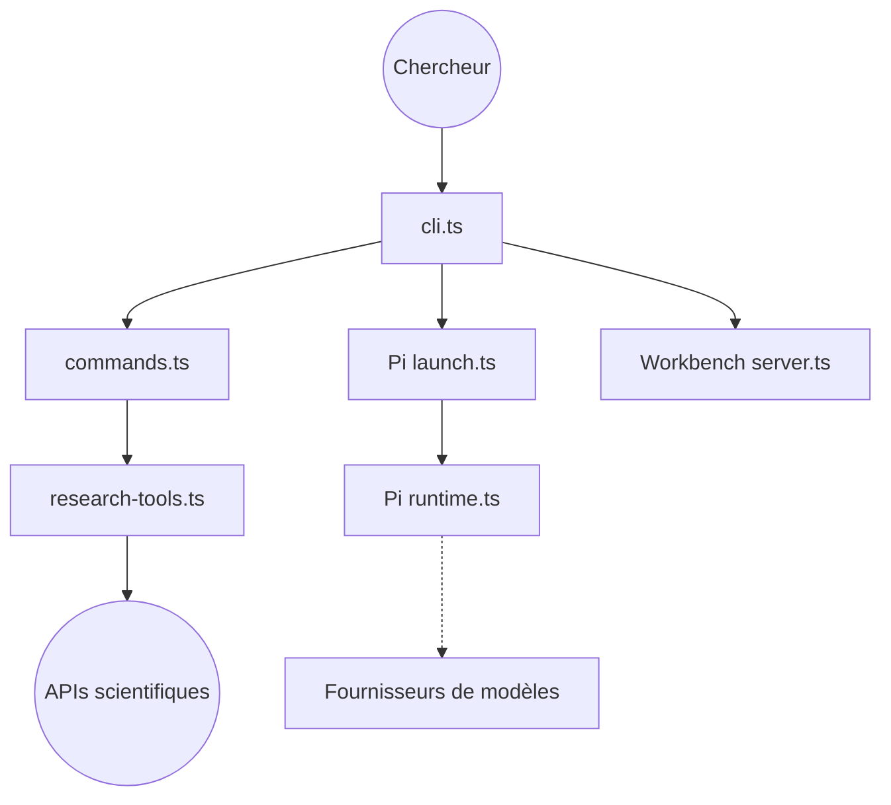

# companion-inc/feynman

> Command-line research agent that searches, reads and cites the scientific literature.

## The problem
A literature review or checking a paper requires manually cross-referencing several databases and public code.

## What it actually does
Workflows (`/deepresearch`, `/lit`, `/review`, `/audit`, `/replicate`, `/recipe`...) query alphaXiv, Semantic Scholar, OpenAlex, arXiv, PubMed and the web. Four agents (researcher, verifier, reviewer, writer) run on Pi. Results go to `outputs/` with a provenance file. A local workbench (server, chat, notebooks, SQLite) exists on the code side.

## How it is wired


## Trying it
```bash
curl -fsSL https://feynman.is/install | bash
feynman setup
feynman lit "RLHF alternatives"
feynman deepresearch "mechanistic interpretability"
```

## Cost and gotchas
A model provider at your expense; free OpenAlex and Semantic Scholar keys against rate limits. PostHog telemetry active by default (`FEYNMAN_TELEMETRY=off`).

## What it is not
Not an oracle: citations still need to be verified. `/replicate` only runs after an environment is chosen.

## Alternatives
No alternative named in the README.

## For you
Worth watching: relevant for ML paper monitoring, with telemetry to disable and model cost to anticipate.
