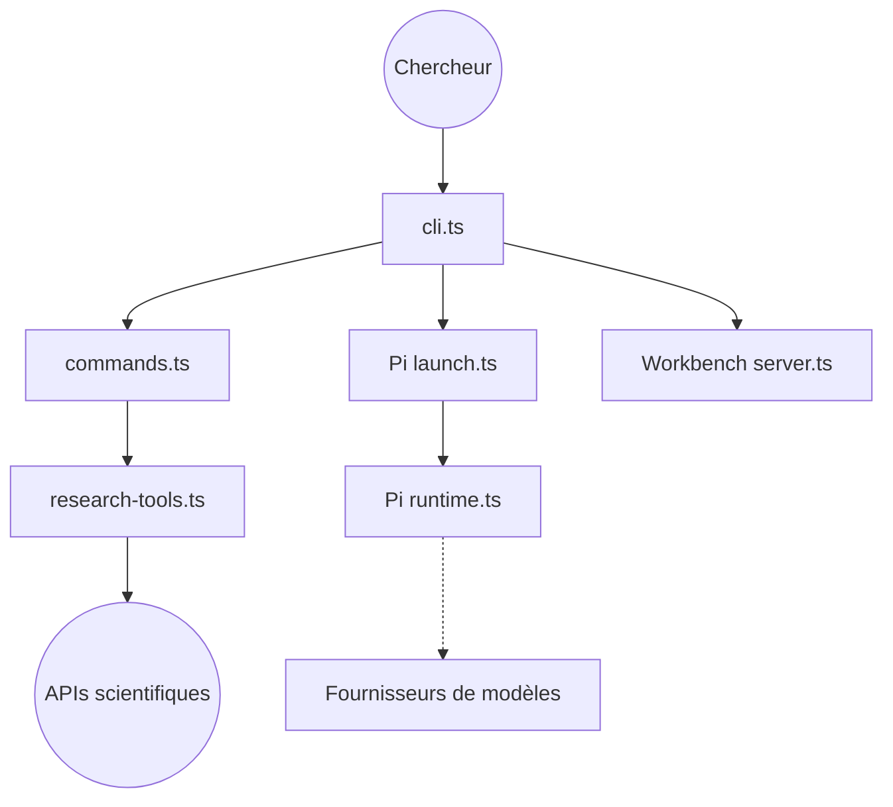

# companion-inc/feynman

> Agent de recherche en ligne de commande qui cherche, lit et cite la littérature scientifique.

## Le problème
Une revue de littérature ou la vérification d'un article exige de croiser à la main plusieurs bases et le code public.

## Ce que ça fait vraiment
Des workflows (`/deepresearch`, `/lit`, `/review`, `/audit`, `/replicate`, `/recipe`…) interrogent alphaXiv, Semantic Scholar, OpenAlex, arXiv, PubMed et le web. Quatre agents (researcher, verifier, reviewer, writer) tournent sur Pi. Les résultats vont dans `outputs/` avec un fichier de provenance. Un workbench local (serveur, chat, notebooks, SQLite) existe côté code.

## Comment c'est branché


## Essayer
```bash
curl -fsSL https://feynman.is/install | bash
feynman setup
feynman lit "RLHF alternatives"
feynman deepresearch "mechanistic interpretability"
```

## Coût et pièges
Un fournisseur de modèle à ta charge ; clés OpenAlex et Semantic Scholar gratuites contre les limites. Télémétrie PostHog active par défaut (`FEYNMAN_TELEMETRY=off`).

## Ce que ce n'est pas
Pas un oracle : les citations restent à vérifier. `/replicate` ne s'exécute qu'après choix d'un environnement.

## Alternatives
Aucune alternative nommée dans le README.

## Pour toi
À surveiller : pertinent pour la veille de papiers ML, avec télémétrie à désactiver et coût de modèle à anticiper.

