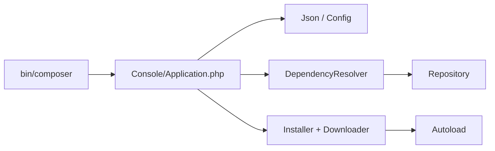

# composer/composer

> Dependency manager for PHP projects, which resolves, downloads and installs packages.

## The problem
A PHP project must declare its libraries, resolve their compatible versions and generate the autoloader.

## What it actually does
Composer reads `composer.json`, resolves dependencies with a solver derived from the libzypp satsolver, queries repositories (Packagist, VCS, files), downloads through downloaders (git, zip) and then generates the autoloader. It has an event and plugin system. It requires PHP 7.2.5+ and, depending on the case, unzip and git.

## How it is wired

## Trying it
No command in the README: it points to the official installation instructions on getcomposer.org.

## Cost and gotchas
Free. Depends on external binaries (git, unzip, possibly hg, svn…). Note: the prerequisite is PHP, not Python (closest value from the imposed list).

## What it is not
Not a manager for Python or Node; does not replace a system package manager.

## Alternatives
No alternative named in the README (Packagist and Private Packagist are package repositories).

## For you
Ignore unless you maintain PHP: excellent in its ecosystem but with no effect on Python data / AI pipelines.
