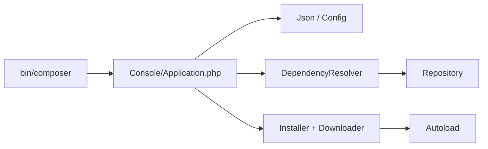

# composer/composer

> Gestionnaire de dépendances pour projets PHP, qui résout, télécharge et installe les paquets.

## Le problème
Un projet PHP doit déclarer ses bibliothèques, résoudre leurs versions compatibles et générer l'autochargement.

## Ce que ça fait vraiment
Composer lit `composer.json`, résout les dépendances avec un solveur issu du satsolver libzypp, interroge des dépôts (Packagist, VCS, fichiers), télécharge via des téléchargeurs (git, zip) puis génère l'autoloader. Il possède un système d'événements et de plugins. Il exige PHP 7.2.5+ et, selon les cas, unzip et git.

## Comment c'est branché

## Essayer
Aucune commande dans le README : renvoi aux instructions officielles d'installation sur getcomposer.org.

## Coût et pièges
Gratuit. Dépend de binaires externes (git, unzip, éventuellement hg, svn…). Note : le prérequis est PHP, pas Python (valeur la plus proche de la liste imposée).

## Ce que ce n'est pas
Pas un gestionnaire pour Python ni Node ; ne remplace pas un gestionnaire de paquets système.

## Alternatives
Aucune alternative nommée dans le README (Packagist et Private Packagist sont des dépôts de paquets).

## Pour toi
À ignorer sauf si tu maintiens du PHP : excellent dans son écosystème mais sans effet sur des chaînes data / IA en Python.

