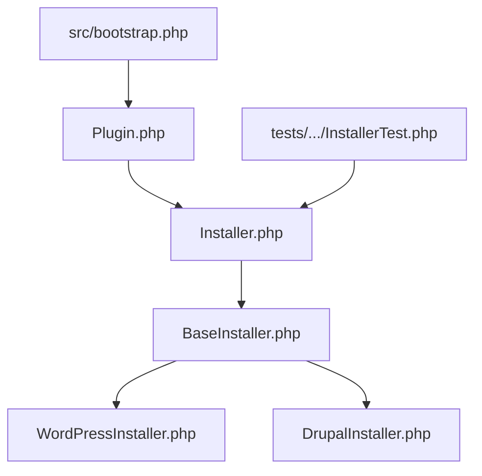

# composer/installers

> Composer plugin for PHP package authors: installs a package to the right folder according to its framework type.

## The problem
PHP CMSs and frameworks (CakePHP, WordPress, Drupal) expect their plugins somewhere other than `vendor`. Without a type-to-path mapping, you need a custom installer per framework.

## What it actually does
Maps a package `type` (for example `cakephp-plugin`) to an install folder. The user can override the path via `installer-paths`, the author can override the name via `installer-name`, and everything can be disabled with `installer-disable`. Dynamic paths chosen by the author are deliberately refused.

## How it is wired


## Trying it
```json
{
    "name": "you/ftp",
    "type": "cakephp-plugin",
    "require": {
        "composer/installers": "~1.0"
    }
}
```
Then `php composer.phar install`.

## Cost and gotchas
Free, nothing to create. PHP and Composer required (not listed in the prerequisites). Useless for frameworks that already install into `vendor`.

## What it is not
Not a universal installer: a special case requires a custom installer. The README recommends, from Composer 2.1 onward, `InstalledVersions::getInstalledPackagesByType` for a new application.

## Alternatives
- Custom Composer installer (Composer documentation): for specific install handling.
- `Composer\InstalledVersions`: to keep everything in `vendor`.

## For you
Ignore: a PHP tool for packaging CMS plugins, unrelated to data, AI or MLOps work.
