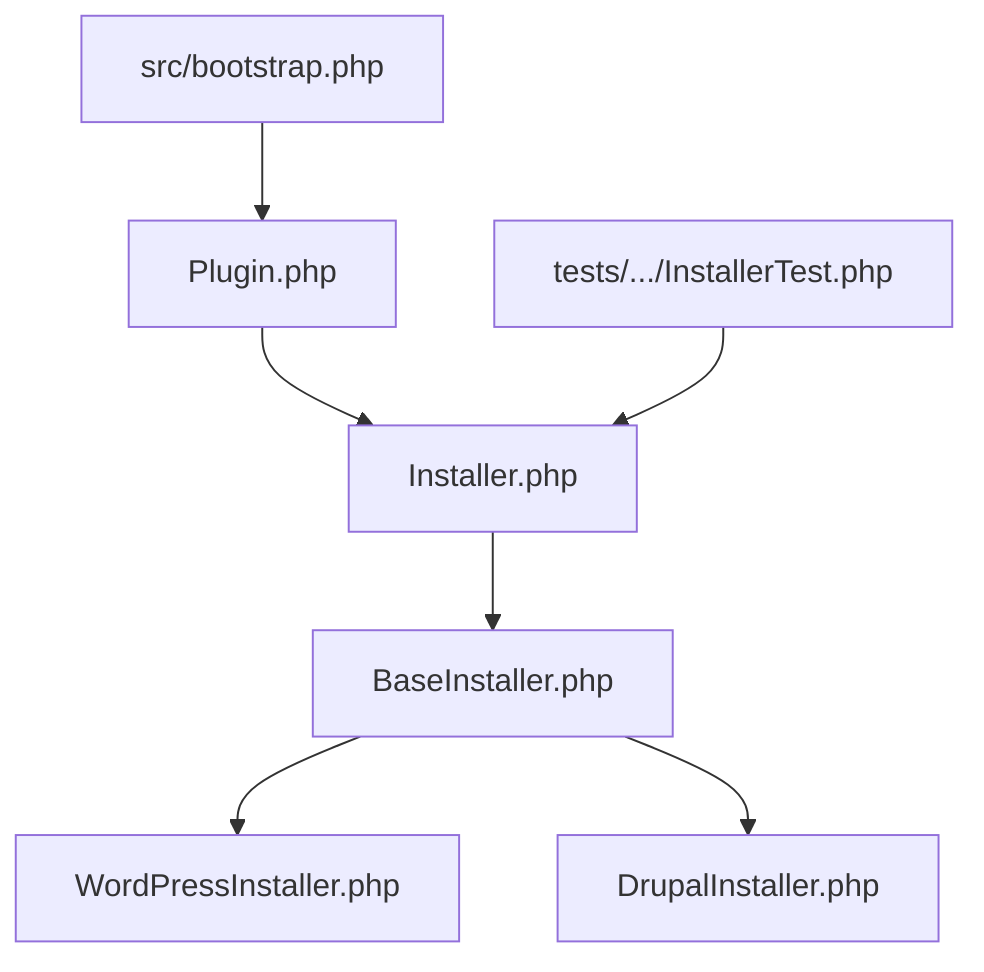

# composer/installers

> Plugin Composer pour auteurs de paquets PHP : installe un paquet au bon dossier selon son type de framework.

## Le problème
Les CMS et frameworks PHP (CakePHP, WordPress, Drupal) attendent leurs plugins ailleurs que dans `vendor`. Sans correspondance type-chemin, il faut un installeur maison par framework.

## Ce que ça fait vraiment
Associe un `type` de paquet (par exemple `cakephp-plugin`) à un dossier d'installation. L'utilisateur peut surcharger le chemin via `installer-paths`, l'auteur le nom via `installer-name`, et tout désactiver avec `installer-disable`. Les chemins dynamiques choisis par l'auteur sont refusés volontairement.

## Comment c'est branché


## Essayer
```json
{
    "name": "you/ftp",
    "type": "cakephp-plugin",
    "require": {
        "composer/installers": "~1.0"
    }
}
```
Puis `php composer.phar install`.

## Coût et pièges
Gratuit, rien à créer. PHP et Composer requis (non listés dans les prérequis). Inutile pour les frameworks qui installent déjà dans `vendor`.

## Ce que ce n'est pas
Ce n'est pas un installeur universel : un cas spécial demande un installeur personnalisé. Le README recommande, dès Composer 2.1, `InstalledVersions::getInstalledPackagesByType` pour une nouvelle application.

## Alternatives
- Installeur Composer personnalisé (documentation Composer) : pour une gestion d'installation spécifique.
- `Composer\InstalledVersions` : pour garder tout dans `vendor`.

## Pour toi
Ignorer : outil PHP d'empaquetage de plugins CMS, sans rapport avec un travail data, IA ou MLOps.

