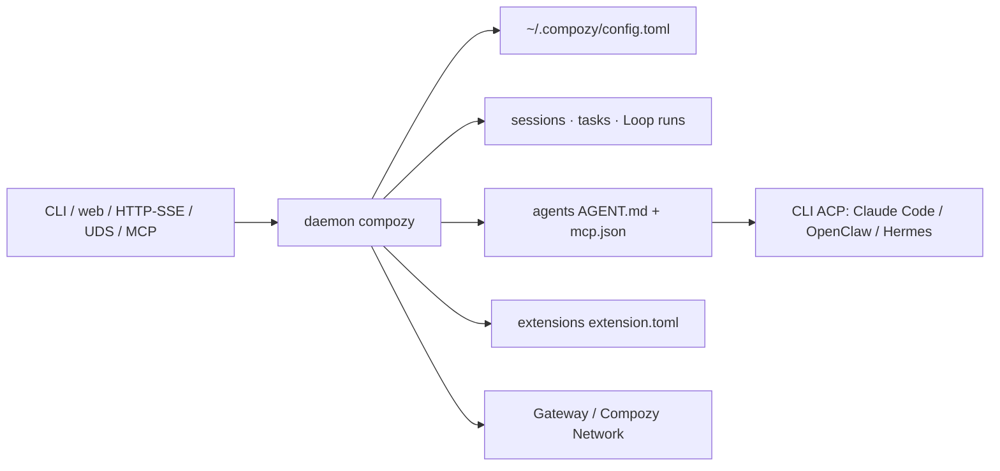

# compozy/compozy

> Local daemon that runs, schedules and supervises agents continuously, for developers and operators.

## The problem
Prompting an agent is easy; running it continuously remains an engineering project:
loops, triggers, cron, memory, permissions, approvals, observability and glue scripts.
Closing the terminal kills the work in progress.

## What it actually does
Sessions, agents, Loops and capabilities are objects you write once and reuse.
Cron scheduling, webhooks and triggers run the work without an open terminal.
Approvals, permissions, run state, artifacts and agent activity stay inspectable
during execution. The daemon owns the state, so closing a client erases nothing.
Drives ACP-compatible CLIs: Claude Code, OpenClaw, Hermes. A Go binary and SQLite stores,
local by default; the Gateway only exposes the surfaces explicitly enabled.
Extensible through agents, skills, capabilities, hooks, bridges and extension kits. Compozy Network lets
sessions discover peers, exchange typed messages and delegate with receipts.

## How it is wired


## Trying it
```bash
curl -fsSL https://compozy.com/install.sh | sh
npm install -g @compozy/cli@beta
compozy install && compozy daemon start
compozy session new --agent general --name first-run
compozy extension init hello --template tool-provider-go
compozy doctor -o json
make dev && make gate
```

## Cost and gotchas
Free on the tool side, but the agents it drives consume your subscriptions or keys.
The v0.3 line is in beta: v0.2.15 is deprecated, maintained only for critical fixes
on `legacy/v0.2`, and migration is mandatory. `go install @latest` still resolves to v0.2:
you need the explicit tag. Homebrew is deliberately absent during the beta.

## What it is not
It is not an agent: it brings no model, it orchestrates CLIs you already have.
It is not compatible with the v0.2 state: the `tasks run` pipeline no longer exists, v0.2 memory
files remain simple repository artifacts. It is not a hosted service.

## Alternatives
None named; only the driven ACP CLIs (Claude Code, OpenClaw, Hermes) are cited.

## For you
The right idea — a daemon that owns agent state — but it is a beta: revisit at stable v0.3.
