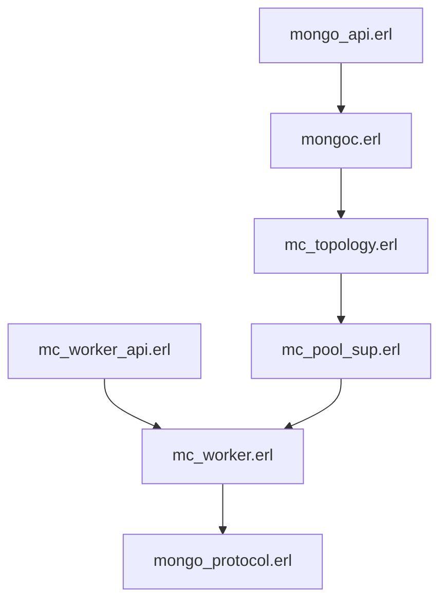

# comtihon/mongodb-erlang

> Erlang driver for MongoDB, with a direct connection or a pool that detects the cluster topology.

## The problem
An Erlang or Elixir application needs to speak the MongoDB protocol without a native driver.

## What it actually does
Two APIs: `mc_worker_api` for a direct connection, `mongo_api` for a `mongoc` pool with topology discovery (single server, replica set, sharded cluster). It does insert, find, update, indexes and raw commands, with authentication. It chooses on its own between OP_MSG and the legacy protocol.

## How it is wired
Diagram based on the code diagram.


## Trying it
```bash
git clone git://github.com/comtihon/mongodb-erlang.git mongodb
cd mongodb
make
```
Then, in Erlang: `application:ensure_all_started(mongodb).`

## Cost and gotchas
Free. Erlang 18 or later and make. A MongoDB server is required. The `mongoc` API is flagged as unstable.

## What it is not
Not an ORM. It has no helpers for administration: commands go through `mc_worker_api:command`.

## Alternatives
No alternative named in the README.

## For you
Ignore: useful only if you write Erlang; in Python, the official drivers are enough.
