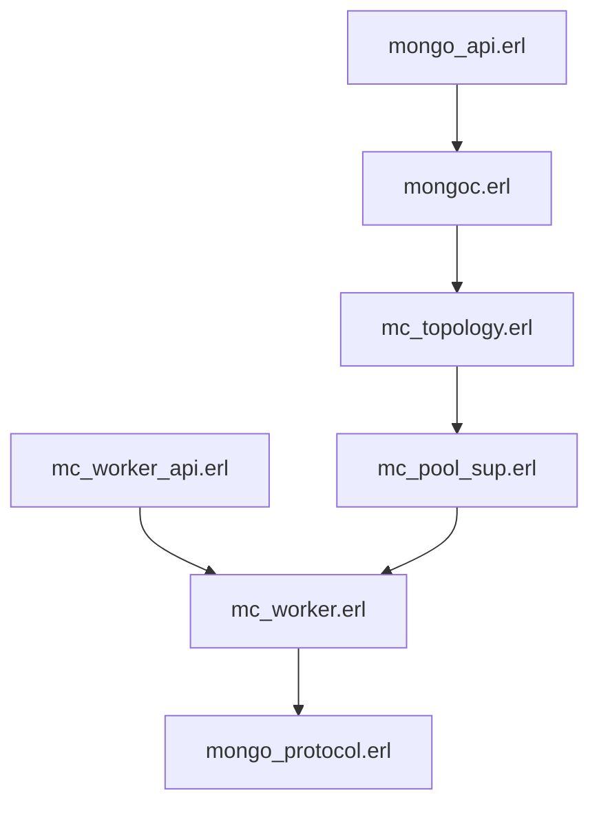

# comtihon/mongodb-erlang

> Pilote Erlang pour MongoDB, avec connexion directe ou pool qui détecte la topologie du cluster.

## Le problème
Une application Erlang ou Elixir doit parler le protocole MongoDB sans pilote natif.

## Ce que ça fait vraiment
Deux API : `mc_worker_api` pour une connexion directe, `mongo_api` pour un pool `mongoc` avec découverte de topologie (serveur seul, jeu de réplicas, cluster shardé). Il fait insertion, recherche, mise à jour, index et commandes brutes, avec authentification. Il choisit seul entre OP_MSG et le protocole historique.

## Comment c'est branché
Schéma d'après le diagramme du code.


## Essayer
```bash
git clone git://github.com/comtihon/mongodb-erlang.git mongodb
cd mongodb
make
```
Puis, dans Erlang : `application:ensure_all_started(mongodb).`

## Coût et pièges
Gratuit. Erlang 18 ou plus et make. Un serveur MongoDB est nécessaire. L'API `mongoc` est signalée comme instable.

## Ce que ce n'est pas
Ce n'est pas un ORM. Il n'a pas d'aides pour l'administration : les commandes passent par `mc_worker_api:command`.

## Alternatives
Aucune alternative nommée dans le README.

## Pour toi
À ignorer : utile seulement si tu écris en Erlang ; en Python, les pilotes officiels suffisent.

