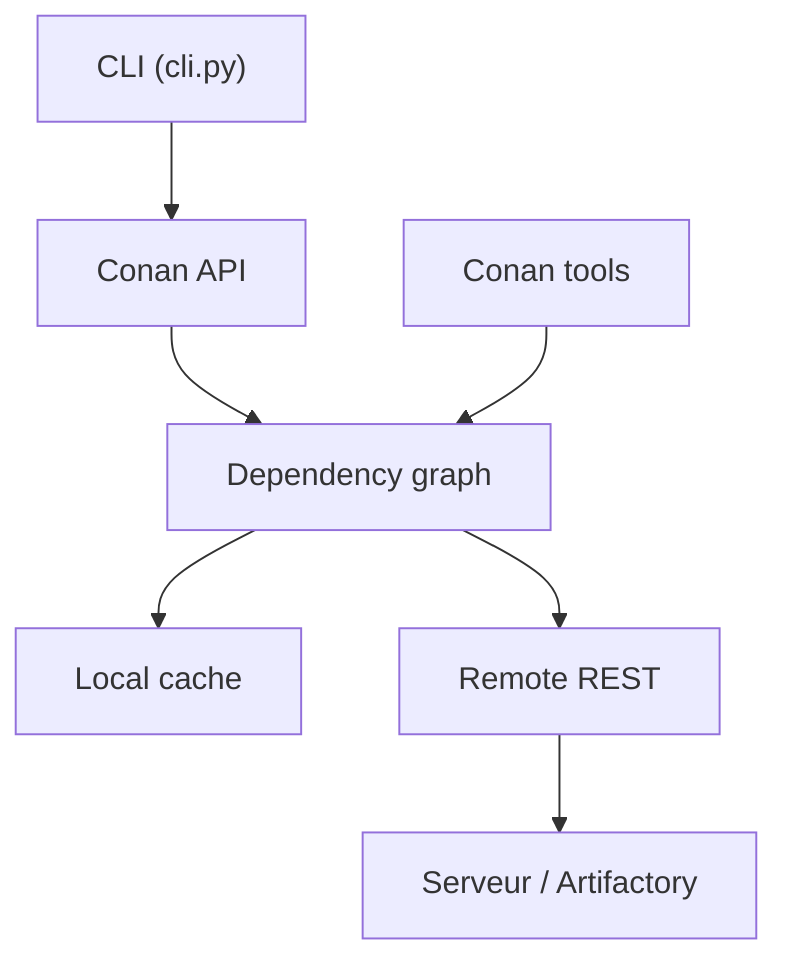

# conan-io/conan

> Decentralized package manager for C and C++, for developers who manage dependencies and binaries.

## The problem
In C/C++, managing dependencies and their binaries per platform, compiler and options is a recurring source of errors.

## What it actually does
The Python client resolves a dependency graph described by `conanfile.py` recipes, looks for binaries in a local cache and then in remote repositories (Artifactory or compatible), builds what is missing and can upload packages. The tools in `conan/tools` generate files for CMake, Meson, MSBuild, Bazel, etc. A legacy Conan server exists in `conans/server`. The README shown here is the maintainer's.

## How it is wired


## Trying it
```bash
git clone https://github.com/conan-io/conan.git conan-io
cd conan-io && pip install -e .
conan --help
python -m pip install -r conans/requirements.txt
python -m pytest .
```

## Cost and gotchas
Free. The name of the clone folder matters for the tests (`conan-io` recommended). Artifactory tests require a dedicated server, because they create repositories.

## What it is not
It is not a build system: it manages packages and generates files for existing build systems.

## Alternatives
No alternative named in the README.

## For you
Keep an eye on it: useful only if you compile C/C++ extensions or inference runtimes; otherwise pip or conda cover your needs.
