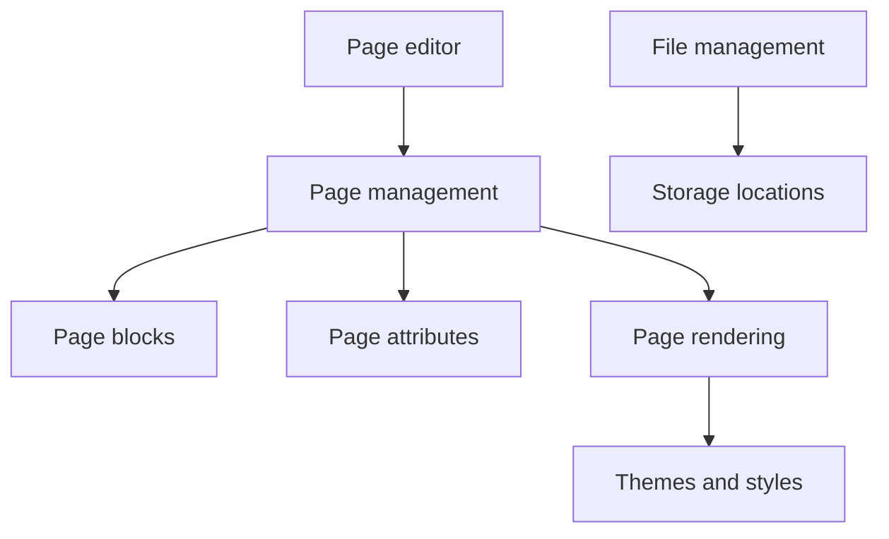

# concretecms/concretecms

> Open source PHP content management system (Concrete CMS 9 and later), for building websites.

## The problem
Site editors want to modify pages without going through a developer.

## What it actually does
Lets you edit pages in a dashboard, compose them with blocks and attributes, then serve them to visitors. It also covers authentication, search, calendar, forms, Express data, files and conversations. File storage administration is the only part detailed by the diagram.

## How it is wired
Schema derived from the code diagram, simplified.


## Trying it
```bash
git clone https://github.com/concretecms/concretecms.git
cd concretecms/
composer install
```

## Cost and gotchas
Free. PHP and Composer are required (not listed); more than 480 open issues. This repository covers version 9 and later.

## What it is not
Not a data or AI tool. Older versions (concrete5) are in other branches.

## Alternatives
No alternative named in the README.

## For you
Ignore: PHP CMS for websites, unrelated to data / AI / MLOps work.
