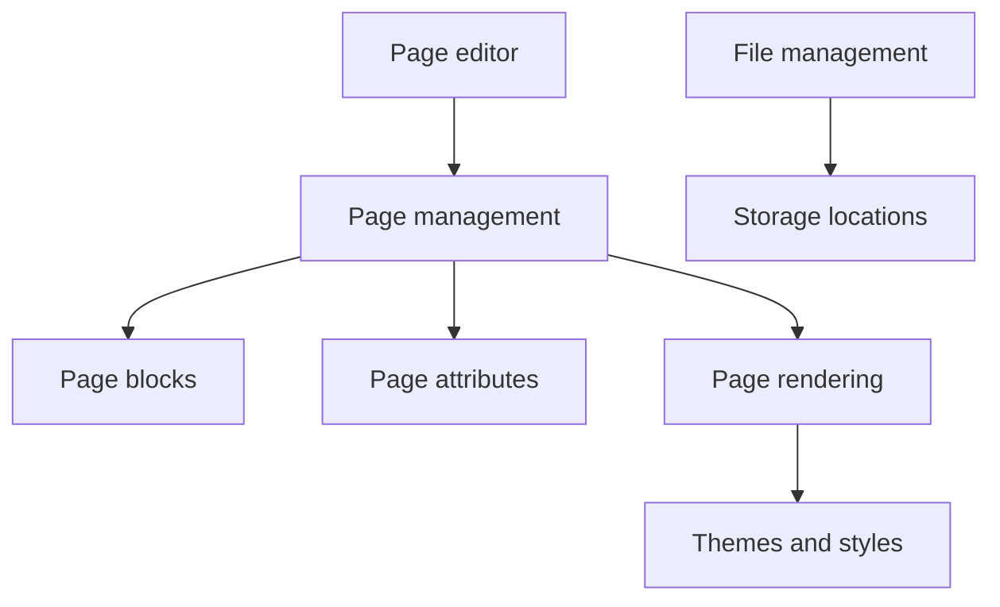

# concretecms/concretecms

> Système de gestion de contenu PHP open source (Concrete CMS 9 et plus), pour construire des sites web.

## Le problème
Les éditeurs de sites veulent modifier les pages sans passer par un développeur.

## Ce que ça fait vraiment
Permet d'éditer des pages dans un tableau de bord, de les composer avec des blocs et des attributs, puis de les servir aux visiteurs. Il couvre aussi authentification, recherche, calendrier, formulaires, données Express, fichiers et conversations. L'administration du stockage de fichiers est la seule partie détaillée par le diagramme.

## Comment c'est branché
Schéma d'après le diagramme du code, simplifié.


## Essayer
```bash
git clone https://github.com/concretecms/concretecms.git
cd concretecms/
composer install
```

## Coût et pièges
Gratuit. PHP et Composer sont requis (non listés) ; plus de 480 issues ouvertes. Ce dépôt concerne la version 9 et suivantes.

## Ce que ce n'est pas
Pas un outil data ou IA. Les anciennes versions (concrete5) sont dans d'autres branches.

## Alternatives
Aucune alternative nommée dans le README.

## Pour toi
À ignorer : CMS PHP pour sites web, sans lien avec un travail data / IA / MLOps.

