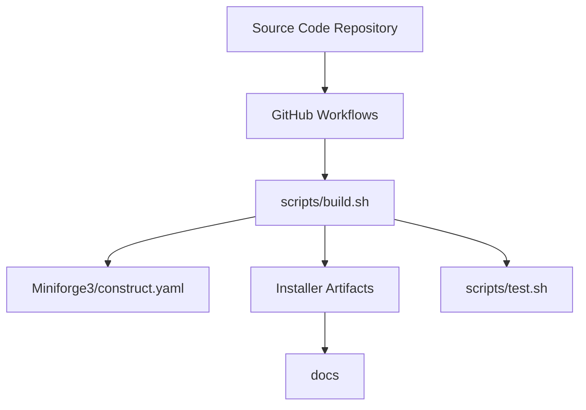

# conda-forge/miniforge

> Minimal installers for conda and mamba, wired by default to the conda-forge channel, for workstations or CI.

## The problem
Getting a clean conda, on all architectures (x86_64, aarch64, ppc64le), without the default channels or their terms.

## What it actually does
Installs conda and mamba with conda-forge as the only channel. Provides scripts for Linux, macOS (also as PKG) and Windows. The installers are tested in CI on several Linux distributions. The repository also contains the build scripts.

## How it is wired



## Trying it
```bash
curl -L -O "https://github.com/conda-forge/miniforge/releases/latest/download/Miniforge3-$(uname)-$(uname -m).sh"
bash Miniforge3-$(uname)-$(uname -m).sh
conda config --set auto_activate false
conda create --name my_project jupyterlab numpy pandas
conda activate my_project
```

## Cost and gotchas
Free. Avoid spaces and special characters in the installation path on Windows; do not go through Homebrew (untested). The license is not identified by GitHub.

## What it is not
Not a full distribution like Anaconda. Mambaforge and PyPy support are deprecated. Apple Silicon, RISC-V and Windows ARM builds are flagged as experimental.

## Alternatives
No alternative named in the README (Miniconda is mentioned only in the FAQ).

## For you
Adopt: a clean entry point for your reproducible Python and AI environments, with conda-forge by default.
