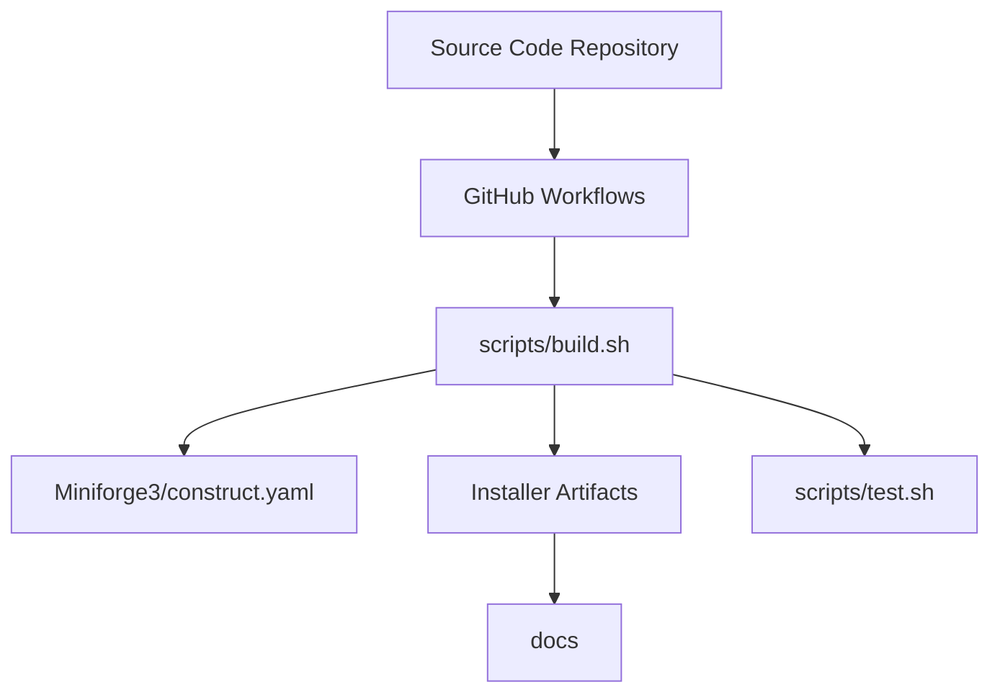

# conda-forge/miniforge

> Installeurs minimaux de conda et mamba, branchés par défaut sur le canal conda-forge, pour poste ou CI.

## Le problème
Obtenir un conda propre, sur toutes les architectures (x86_64, aarch64, ppc64le), sans les canaux par défaut ni leurs conditions.

## Ce que ça fait vraiment
Installe conda et mamba avec conda-forge comme unique canal. Fournit des scripts pour Linux, macOS (aussi en PKG) et Windows. Les installeurs sont testés en CI sur plusieurs distributions Linux. Le dépôt contient aussi les scripts de construction.

## Comment c'est branché



## Essayer
```bash
curl -L -O "https://github.com/conda-forge/miniforge/releases/latest/download/Miniforge3-$(uname)-$(uname -m).sh"
bash Miniforge3-$(uname)-$(uname -m).sh
conda config --set auto_activate false
conda create --name my_project jupyterlab numpy pandas
conda activate my_project
```

## Coût et pièges
Gratuit. Éviter les espaces et caractères spéciaux dans le chemin d'installation sous Windows ; ne pas passer par Homebrew (non testé). La licence n'est pas identifiée par GitHub.

## Ce que ce n'est pas
Pas une distribution complète façon Anaconda. Mambaforge et le support PyPy sont dépréciés. Les builds Apple Silicon, RISC-V et Windows ARM sont signalés comme expérimentaux.

## Alternatives
Aucune alternative nommée dans le README (Miniconda est évoqué seulement dans la FAQ).

## Pour toi
À adopter : point d'entrée propre pour tes environnements Python et IA reproductibles, avec conda-forge par défaut.

