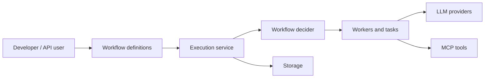

# conductor-oss/conductor

> Durable execution engine for workflows and AI agents, born at Netflix, for microservices teams.

## The problem
Long chains of steps (API calls, LLMs, human approvals) that must survive failures, be replayable and inspectable.

## What it actually does
Workflows are versioned JSON graphs; workers, in any language (Java, Python, Go, JS, C#, Ruby, Rust), poll the server, execute and report back. Each step is persisted, with retry, pause, resume, restart and termination. Native tasks cover LLMs, MCP tools, RAG and human approval. 5 persistence backends and 6 message brokers are advertised.

## How it is wired


## Trying it
```bash
npm install -g @conductor-oss/conductor-cli
conductor server start
conductor workflow create workflow.json
conductor workflow start -w hello_workflow --sync
```

## Cost and gotchas
Free (Apache-2.0) but Java 21+ and Node 16+ required. LLM tasks call providers (example with OpenAI): API key and bill are on you. Orkes sells the SaaS offering.

## What it is not
Not a code-based agent framework: orchestration is declared in JSON. The engine does not replay your code, unlike Temporal.

## Alternatives
No alternative cited in the README (it implicitly compares itself to "code-first" engines).

## For you
Worth watching: interesting for orchestrating pipelines and agents with crash recovery, but the JSON model and Java stack demand an investment that a simple Python pipeline does not justify.
