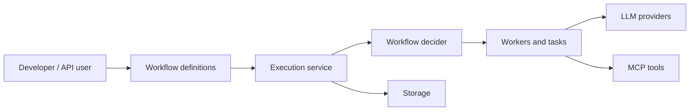

# conductor-oss/conductor

> Moteur d'exécution durable de workflows et d'agents IA, issu de Netflix, pour équipes de microservices.

## Le problème
Des enchaînements longs (appels d'API, LLM, validations humaines) qui doivent survivre aux pannes, être rejouables et inspectables.

## Ce que ça fait vraiment
Les workflows sont des graphes JSON versionnés ; les workers, en n'importe quel langage (Java, Python, Go, JS, C#, Ruby, Rust), interrogent le serveur, exécutent et rapportent. Chaque étape est persistée, avec retry, pause, reprise, relance et terminaison. Des tâches natives couvrent LLM, outils MCP, RAG et approbation humaine. 5 backends de persistance et 6 brokers de messages sont annoncés.

## Comment c'est branché


## Essayer
```bash
npm install -g @conductor-oss/conductor-cli
conductor server start
conductor workflow create workflow.json
conductor workflow start -w hello_workflow --sync
```

## Coût et pièges
Gratuit (Apache-2.0) mais Java 21+ et Node 16+ requis. Les tâches LLM appellent des fournisseurs (exemple avec OpenAI) : clé d'API et facture à ta charge. Orkes vend l'offre SaaS.

## Ce que ce n'est pas
Pas un framework d'agents en code : l'orchestration est déclarée en JSON. Le moteur ne rejoue pas ton code, contrairement à Temporal.

## Alternatives
Aucune alternative citée dans le README (il se compare implicitement aux moteurs « code-first »).

## Pour toi
À surveiller : intéressant pour orchestrer des pipelines et agents avec reprise après panne, mais le modèle JSON et la pile Java demandent un investissement qu'un simple pipeline Python ne justifie pas.

