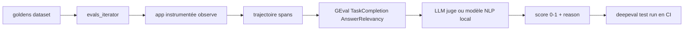

# confident-ai/deepeval

> Evaluation framework for LLM systems, built like pytest but for agents, RAG and chatbots.

## The problem
Knowing whether a prompt or model change improves your application often comes down to gut feeling.
Without a reproducible metric, you can neither compare two versions nor detect a regression.

## What it actually does
A catalog of metrics with explanations: G-Eval, DAG, agentic, RAG, multi-turn, MCP, multimodal.
Metrics run with the LLM of your choice, statistical methods or local NLP models.
`deepeval test run test_chatbot.py` integrates with pytest and any CI; `evaluate()` works outside pytest.
`evals_iterator()` and `@observe()` trace the full trajectory so you can evaluate each step of an agent.

## How it is wired


## Trying it
```bash
pip install -U deepeval
export OPENAI_API_KEY="..."
touch test_chatbot.py
deepeval test run test_chatbot.py
```
Integrations (LangChain, LangGraph, CrewAI, Pydantic AI, OpenAI Agents, LlamaIndex, Google ADK, Strands)
plug in through a `CallbackHandler` or an `instrument_*()`.

## Cost and gotchas
LLM-as-a-judge metrics consume tokens on every run: a full suite costs money.
DeepEval loads `.env.local` then `.env` from the current directory at import; set `DEEPEVAL_DISABLE_DOTENV=1` to opt out.

## What it is not
Not neutral toward its platform: `deepeval login` pushes test cases to Confident AI, which is a choice you have to make.
Not entirely local: only some metrics run on your machine, the others call a judge model.
Not a quality guarantee: an LLM judge also has an error rate, to be calibrated on known cases.

## Alternatives
`Pydantic Evals` — cited in the Pydantic AI ecosystem for the same need in typed Python.
`RAGAS` — present here as an aggregated metric rather than as a competing framework.

## For you
The missing link between your RAG pipeline and a CI: start with one metric, not the whole catalog.
