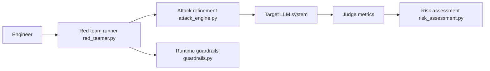

# confident-ai/deepteam

> Python framework that tests the robustness and security of your own LLM applications, with guardrails.

## The problem
An agent, a RAG pipeline or a chatbot can leak data, be hijacked or produce problematic content, and this is discovered in production.

## What it actually does
You wrap your application in a `model_callback`. DeepTeam generates test scenarios from chosen vulnerabilities (bias, personal data leakage, authorizations, agent drift, more than 50) and from single-turn or multi-turn attacks, then scores the responses with LLM-judge metrics (binary score with justification), locally. It can align with OWASP, NIST, MITRE ATLAS, and offers 7 input/output guardrails. CLI (YAML) or Python usage.

## How it is wired


## Trying it
```bash
pip install -U deepteam
python red_team_llm.py
```
The script `red_team_llm.py` uses `red_team(model_callback=..., vulnerabilities=[Bias(types=["race"])], attacks=[PromptInjection()])`; `OPENAI_API_KEY` must be set (or another model supported by DeepEval).

## Cost and gotchas
Attacks and judges are generated by an LLM: API calls billed to you (OpenAI key by default). The volume of calls grows with the number of vulnerabilities and attacks chosen. The Confident AI platform is optional, as SaaS.

## What it is not
A tool to be used only on systems you own or for which you have explicit authorization to test. It replaces neither a human security audit nor a compliance guarantee: scores depend on the judge model.

## Alternatives
- DeepEval: LLM evaluation framework on which DeepTeam is built.

## For you
Adopt: it fits into an LLM/MLOps evaluation cycle, runs locally under Apache-2.0 and covers the OWASP/NIST frameworks, provided you budget for the API calls.
