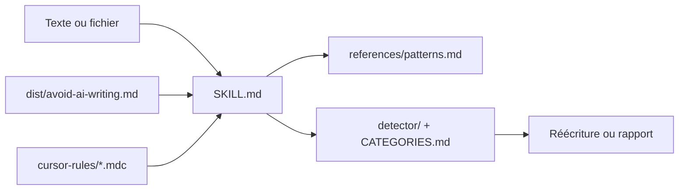

# conorbronsdon/avoid-ai-writing

> Portable skill that spots and rewrites LLM writing tics in a text.

## The problem
LLM-produced texts are recognizable: "leverage", "seamless", hollow conclusions.
A "make it human" prompt catches the obvious and lets the rest through.

## What it actually does
Three modes: rewrite (default), detection only, and in-place editing of a prose file.
A table of 112 replacements across three tiers, plus 74 documented pattern categories.
The cap on editing passes is set with `--iterate 1|2`; the skill reports the passes used.
A voice profile (casual, professional, technical, warm, blunt) steers the tone independently of context.

## How it is wired


## Trying it
```bash
git clone https://github.com/conorbronsdon/avoid-ai-writing ~/.claude/skills/avoid-ai-writing
```

## Cost and gotchas
Nothing to pay, nothing to install beyond a clone; the real cost is in tokens of the agent running it.
Keep `SKILL.md` together with `references/patterns.md`: the entry file alone is not enough.

## What it is not
Not a reliable detector of origin: several patterns are explicitly judgments, not rules.
Not meant for code or configuration — the edit mode refuses them.
Not a substantive corrector: it touches style, not accuracy.

## Alternatives
No alternative named in the README.

## For you
Useful if you publish readable watch notes; test it on a text before making it a habit.
