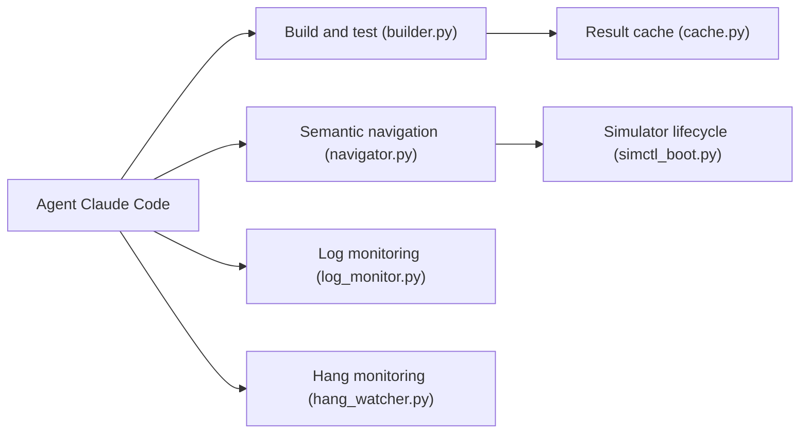

# conorluddy/ios-simulator-skill

> Claude Code skill of 29 scripts to build, test and drive the iOS simulator.

## The problem
Raw outputs from `xcodebuild` and the simulator consume a lot of tokens, and coordinate-based taps are fragile.

## What it actually does
Python scripts wrapping `xcodebuild`, `xcrun simctl` and `idb`. The build returns a one-line summary with an xcresult identifier, detailed on demand; navigation goes through the accessibility tree rather than coordinates. Adds accessibility and localization audits, visual diff, logs, "hang" tracking (HangBuster), app state capture. All caps are adjustable via `IOS_SIM_*`.

## How it is wired


## Trying it
```bash
/plugin marketplace add conorluddy/ios-simulator-skill
/plugin install ios-simulator-skill@conorluddy
bash scripts/sim_health_check.sh
```

## Cost and gotchas
Free. Requires macOS 15+, Xcode 26+, Python 3.12+ and `idb` 1.5.1+ (Homebrew, Meta tap); under Xcode 27, an old `idb-companion` silently ignores taps and keystrokes.

## What it is not
Only works on a Mac with Xcode. The eval figures (100% versus 46%, 3 cases) are a very small sample.

## Alternatives
XC-MCP (MCP version on NPM) and xclaude-plugin (Xcode tooling only).

## For you
Ignore: useful only for iOS development, outside the data/AI/MLOps scope; interesting only as an example of a token-efficient skill.
