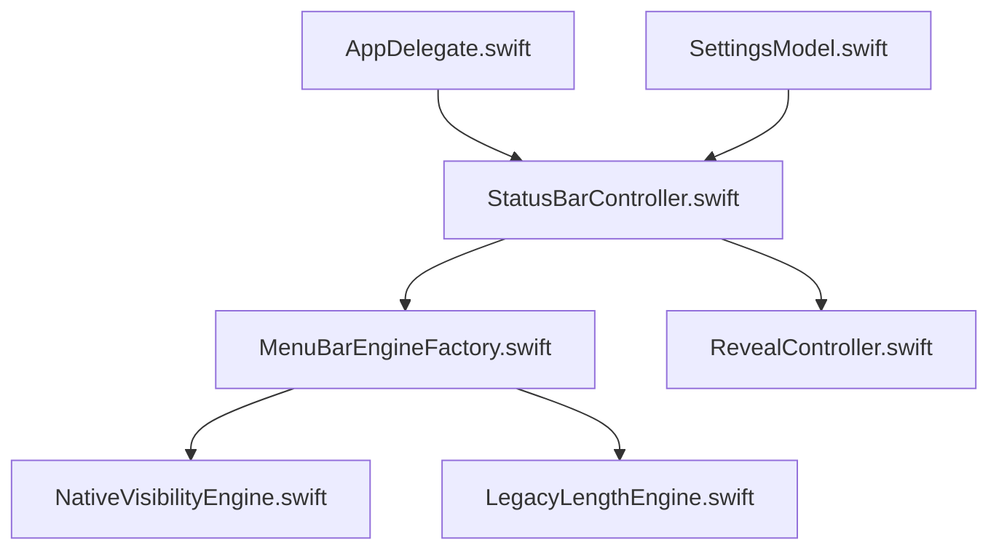

# consolelabs/hidden

> macOS application that hides menu bar icons for a cleaner desktop.

## The problem
A macOS menu bar crowded with icons becomes unreadable.

## What it actually does
An arrow in the bar hides or reveals the icons to its left. Option-click for an always-hidden section. Settings: delay, global shortcut, reveal on hover, on scroll or by shaking. The code picks a native engine or a legacy engine via MenuBarEngineFactory.

## How it is wired


## Trying it
```bash
brew install --cask hiddenbar
```

## Cost and gotchas
Free. macOS 13 minimum (v1.10 covers 10.13 to 12). The sandboxed App Store version cannot hide icons on macOS 27: use GitHub or Homebrew.

## What it is not
Not a launcher nor a window manager. Only GitHub, Homebrew and the App Store are official, according to the README.

## Alternatives
No alternative named in the README (it points to Blurred and VimMotion from the same publisher).

## For you
Ignore: a macOS comfort utility unrelated to data / AI / MLOps work.
