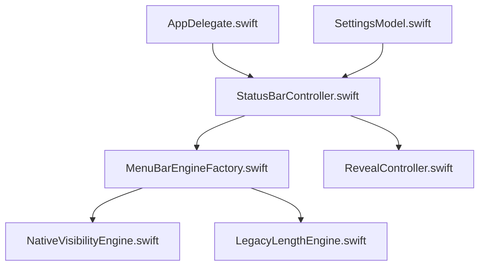

# consolelabs/hidden

> Application macOS qui masque des icônes de la barre de menus pour un bureau plus propre.

## Le problème
Une barre de menus macOS saturée d'icônes devient illisible.

## Ce que ça fait vraiment
Une flèche dans la barre masque ou révèle les icônes à sa gauche. Option-clic pour une section toujours masquée. Réglages : délai, raccourci global, révélation au survol, au défilement ou par secousse. Le code choisit un moteur natif ou un moteur historique via MenuBarEngineFactory.

## Comment c'est branché


## Essayer
```bash
brew install --cask hiddenbar
```

## Coût et pièges
Gratuit. macOS 13 minimum (la v1.10 couvre 10.13 à 12). La version App Store, sandboxée, ne peut pas masquer les icônes sous macOS 27 : utiliser GitHub ou Homebrew.

## Ce que ce n'est pas
Pas un lanceur ni un gestionnaire de fenêtres. Seuls GitHub, Homebrew et l'App Store sont officiels, selon le README.

## Alternatives
Aucune alternative nommée dans le README (renvoi vers Blurred et VimMotion du même éditeur).

## Pour toi
Ignorer : utilitaire de confort macOS sans rapport avec le travail data / IA / MLOps.

