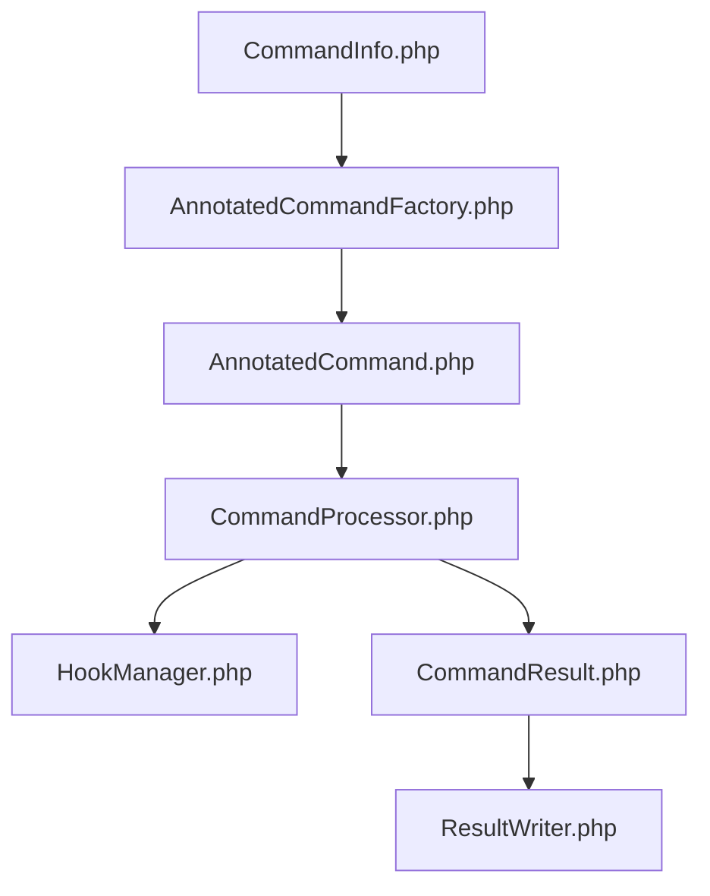

# consolidation/annotated-command

> PHP library that creates Symfony Console commands from annotated or attribute-based methods.

## The problem
Declaring the arguments, options and help of a Symfony Console command takes a lot of configuration code.

## What it actually does
The factory reads docblocks or PHP 8 attributes and produces `AnnotatedCommand` objects. The `CommandProcessor` runs them with ten types of hooks, then `ResultWriter` formats the output. Used by Robo, Drush and Terminus. The README is truncated.

## How it is wired


## Trying it
```bash
# composer.json : "consolidation/annotated-command": "^4"
```

## Cost and gotchas
Free. PHP and Composer required (not on the list). License present but not identified.

## What it is not
Not a full framework: Robo, built on top of it, is recommended to get started.

## Alternatives
Robo: a framework built on this library.

## For you
Ignore: PHP/Symfony tooling unrelated to your data/AI/MLOps stack.
