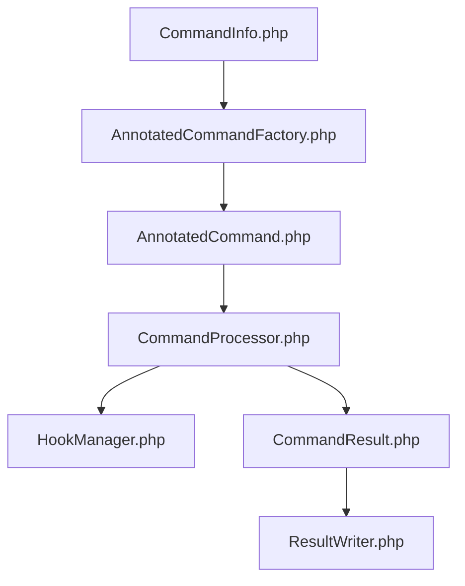

# consolidation/annotated-command

> Bibliothèque PHP qui crée des commandes Symfony Console depuis des méthodes annotées ou à attributs.

## Le problème
Déclarer arguments, options et aide d'une commande Symfony Console demande beaucoup de code de configuration.

## Ce que ça fait vraiment
La fabrique lit docblocks ou attributs PHP 8 et produit des `AnnotatedCommand`. Le `CommandProcessor` les exécute avec dix types de hooks, puis `ResultWriter` formate la sortie. Utilisée par Robo, Drush et Terminus. Le README est tronqué.

## Comment c'est branché


## Essayer
```bash
# composer.json : "consolidation/annotated-command": "^4"
```

## Coût et pièges
Gratuit. PHP et Composer requis (hors liste). Licence présente mais non identifiée.

## Ce que ce n'est pas
Pas un framework complet : Robo, bâti dessus, est recommandé pour démarrer.

## Alternatives
Robo : framework bâti sur cette bibliothèque.

## Pour toi
À ignorer : outillage PHP/Symfony sans rapport avec ta pile data/IA/MLOps.

