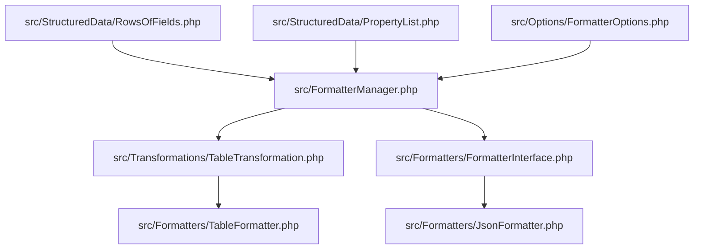

# consolidation/output-formatters

> PHP library that formats structured data (table, JSON, YAML) for console commands.

## The problem
A console command that writes its own output is tied to Symfony Console and hard to offer in several formats.

## What it actually does
The command returns structured data (RowsOfFields, PropertyList…). The FormatterManager transforms it according to user options (--format, --fields), then a formatter writes the result. Any new format is automatically available to compatible commands.

## How it is wired


## Trying it
```bash
# composer.json
"require": {
    "consolidation/output-formatters": "^4"
}
```

## Cost and gotchas
Free; PHP and Composer are needed (missing from the prerequisites list). The README points to Consolidation/AnnotatedCommand for normal use.

## What it is not
Not a standalone tool: a building block for other projects (Drush). Does not produce faithful XML output from a plain PHP array.

## Alternatives
No alternative named, apart from the Drush formatters it draws from.

## For you
Ignore: PHP command-line building block, no use in data/AI/MLOps work.
