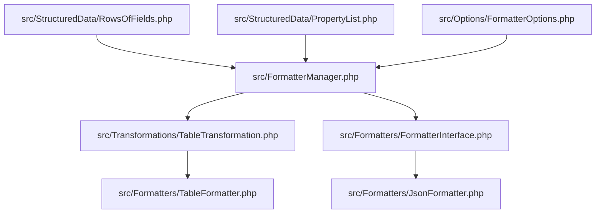

# consolidation/output-formatters

> Bibliothèque PHP qui met en forme des données structurées (tableau, JSON, YAML) pour les commandes console.

## Le problème
Une commande console qui écrit elle-même son affichage est liée à Symfony Console et difficile à décliner en plusieurs formats.

## Ce que ça fait vraiment
La commande renvoie des données structurées (RowsOfFields, PropertyList…). Le FormatterManager les transforme selon les options utilisateur (--format, --fields) puis un formateur écrit le résultat. Tout nouveau format est disponible automatiquement pour les commandes compatibles.

## Comment c'est branché


## Essayer
```bash
# composer.json
"require": {
    "consolidation/output-formatters": "^4"
}
```

## Coût et pièges
Gratuit ; il faut PHP et Composer (absents de la liste des prérequis). Le README renvoie à Consolidation/AnnotatedCommand pour l'usage normal.

## Ce que ce n'est pas
Pas un outil autonome : une brique pour d'autres projets (Drush). Ne produit pas de sortie XML fidèle à partir d'un simple tableau PHP.

## Alternatives
Aucune alternative nommée, hors les formateurs de Drush dont il s'inspire.

## Pour toi
À ignorer : brique PHP de ligne de commande, sans usage dans un travail data/IA/MLOps.

