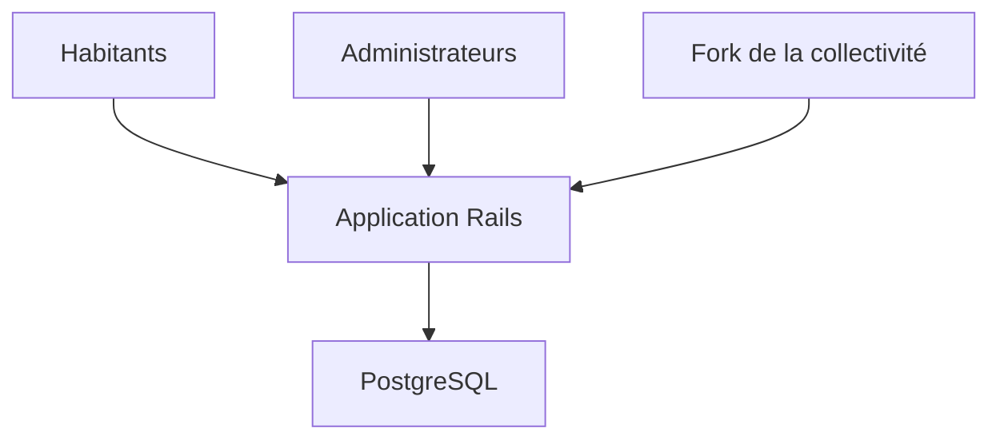

# consuldemocracy/consuldemocracy

> Web platform for citizen participation, used by local authorities, maintained by the community and a foundation.

## The problem
An administration that wants to open debates, proposals and votes to its residents has to build or buy a dedicated platform.

## What it actually does
Rails application born for the City of Madrid's participation site, in production since September 2015. It is deployed by forking, with an installer for production. The README does not detail the features: it points to the project website and the documentation.

## How it is wired
Simplified diagram based on the sheet, no diagram provided.


## Trying it
```bash
git clone https://github.com/consuldemocracy/consuldemocracy.git
cd consuldemocracy
bin/setup
bin/rake db:dev_seed
bin/rails s
bin/rspec
```

## Cost and gotchas
Free, but plan for Ruby 3.4.11, Node.js 22.23.3, PostgreSQL 13 or later, CMake and ImageMagick. The full test suite can take over an hour on a local machine. AGPL license.

## What it is not
Not a reusable library: it is a complete application to fork and customize. No data or AI component.

## Alternatives
No alternative named in the README.

## For you
Ignore: Rails civic platform unrelated to your data/AI/MLOps profile, useful only if a citizen participation project comes up.
