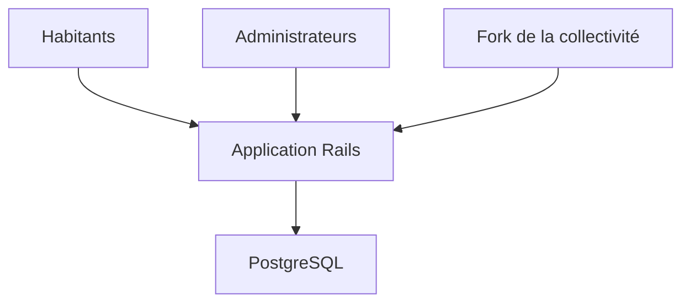

# consuldemocracy/consuldemocracy

> Plateforme web de participation citoyenne, utilisée par des collectivités, maintenue par la communauté et une fondation.

## Le problème
Une administration qui veut ouvrir débats, propositions et votes à ses habitants doit bâtir ou acheter une plateforme dédiée.

## Ce que ça fait vraiment
Application Rails née pour le site de participation de la ville de Madrid, en production depuis septembre 2015. Elle se déploie par fork, avec un installateur pour la production. Le README ne détaille pas les fonctions : il renvoie au site du projet et à la documentation.

## Comment c'est branché
Schéma simplifié d'après la fiche, sans diagramme fourni.


## Essayer
```bash
git clone https://github.com/consuldemocracy/consuldemocracy.git
cd consuldemocracy
bin/setup
bin/rake db:dev_seed
bin/rails s
bin/rspec
```

## Coût et pièges
Gratuit, mais prévoir Ruby 3.4.11, Node.js 22.23.3, PostgreSQL 13 ou plus, CMake et ImageMagick. La suite de tests complète peut dépasser une heure sur une machine locale. Licence AGPL.

## Ce que ce n'est pas
Pas une bibliothèque réutilisable : c'est une application complète à forker et à personnaliser. Aucun volet data ou IA.

## Alternatives
Aucune alternative nommée dans le README.

## Pour toi
Ignorer : plateforme civique Rails sans rapport avec ton profil data/IA/MLOps, utile seulement si une mission de participation citoyenne se présente.

