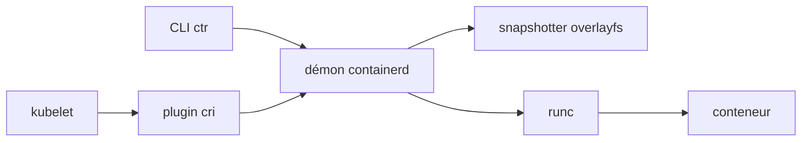

# containerd/containerd

> Daemon that manages the container lifecycle of a machine, designed to be embedded.

## The problem
Running containers requires coordinating images, storage, networking and supervision.
Writing this plumbing yourself, or depending on a full engine, is expensive.

## What it actually does
Image transfer and storage, container execution and supervision, storage and network attachment.
Daemon available on Linux and Windows; low-level work goes through `runc` (Linux) or hcsshim (Windows).
The `cri` plugin has been built into the release binaries since 1.1 and is enabled by default: it is what Kubernetes calls.
The default snapshotter is overlayfs; btrfs is a documented alternative.

## How it is wired


## Trying it
```bash
source ./contrib/autocomplete/ctr
```
The README documents no installation command: it points to containerd.io, the releases page, the
nightly builds and `BUILDING` for compilation.

## Cost and gotchas
Linux kernel 4.x minimum for overlayfs, 3.18 for btrfs (with the btrfs module and tools installed).
`criu` is required for checkpoint/restore; the required `runc` version is pinned in `RUNC.md`.

## What it is not
Not a tool aimed at developers or end users: it is designed to be embedded.
Not a replacement for Docker in terms of experience: `ctr` is a service client, not a working CLI.
Nightly builds are explicitly discouraged in production, with no support.

## Alternatives
`runc` — it is the layer below, not a competitor: containerd calls it.
`cri-tools` / `critest` — to validate a CRI implementation rather than run it.

## For you
You already use it without knowing it under Kubernetes: worth knowing for debugging, not for installing.
