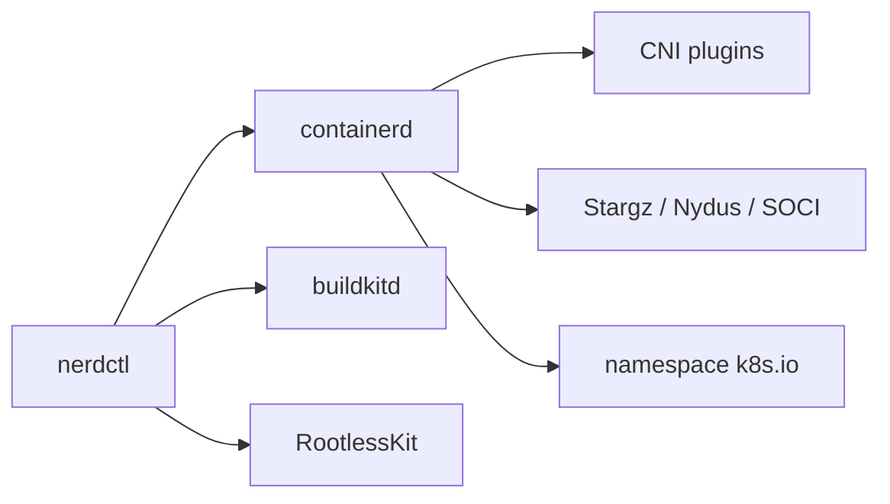

# containerd/nerdctl

> Docker-compatible CLI for containerd, unlocking features missing from Docker.

## The problem
containerd on its own is used with `ctr` or `crictl`, which are incompatible with the Docker CLI and unfriendly: no `run -p`, no `logs`, no `build`, no `compose`.

## What it actually does
Reproduces the ergonomics of `docker` (`run`, `build`, `compose up`, `logs`, `load`, `save`) on containerd, and adds lazy-pulling (Stargz, Nydus, OverlayBD, SOCI), image encryption via ocicrypt, P2P distribution through IPFS, cosign verification, rootless mode accelerated by bypass4netns, and namespacing (`--namespace k8s.io` to debug a cluster). A **non-core** containerd subproject, Apache 2.0.

## How it is wired


## Trying it
```bash
nerdctl run -it --rm alpine
nerdctl build -t foo /some-dockerfile-directory
nerdctl compose -f ./examples/compose-wordpress/docker-compose.yaml up
nerdctl --namespace k8s.io ps -a
brew install nerdctl
```

## Cost and gotchas
Free. You need containerd plus the CNI plugins; BuildKit for `build`, RootlessKit for rootless. The `nerdctl-full` archive bundles them, the plain archive does not. macOS goes through Lima; Windows through Scoop, with Windows containers experimental. IPFS is strictly opt-in.

## What it is not
Not a Docker competitor: the project says so, the goal is to expose containerd's advanced features until Docker adopts them. Not an extra daemon either.

## Alternatives
- **ctr**: ships with containerd, but is Docker-incompatible and has no `run -p`, `logs`, `build`, `compose`.
- **crictl**: CRI-oriented, does not cover non-CRI features.
- **Rancher Kim**: requires Kubernetes, limited to image management.

## For you
The right tool for inspecting and rebuilding images directly on a Kubernetes node.
