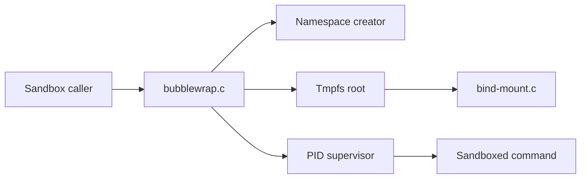

# containers/bubblewrap

> Command-line tool to build an unprivileged Linux sandbox, using namespaces.

## The problem
Docker and systemd-nspawn cannot be handed to unprivileged users: access amounts to root. The goal is to isolate a process without being root.

## What it actually does
`bwrap` creates a mount namespace with an empty tmpfs root, then mounts the visible paths on demand (read-only possible). Options: user, IPC, PID, network and UTS namespaces, seccomp filters, `PR_SET_NO_NEW_PRIVS`. The level of protection depends entirely on the arguments passed.

## How it is wired


## Trying it
```bash
bwrap --ro-bind /usr /usr --symlink usr/lib64 /lib64 --proc /proc --dev /dev --unshare-pid --new-session bash
```

## Cost and gotchas
Free. Available in distribution packages; otherwise build with meson. License not identified by GitHub: to be checked. The setuid mode has been removed.

## What it is not
Not a ready-to-use sandbox with a security policy: anything you mount can be used to escape (a D-Bus socket, for example).

## Alternatives
Firejail and runC (compared in the README): more features or more complete, but different trade-offs.

## For you
Keep an eye on it: a low-level building block to isolate untrusted code, to choose if you master the isolation arguments.
