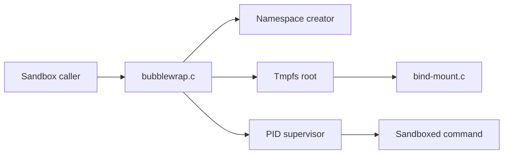

# containers/bubblewrap

> Outil en ligne de commande pour construire un bac à sable Linux sans privilèges, via les espaces de noms.

## Le problème
Docker et systemd-nspawn ne se donnent pas à des utilisateurs non privilégiés : un accès équivaut à root. On veut isoler un processus sans être root.

## Ce que ça fait vraiment
`bwrap` crée un espace de noms de montage avec une racine tmpfs vide, puis monte à la demande les chemins visibles (lecture seule possible). Options : espaces de noms utilisateur, IPC, PID, réseau, UTS, filtres seccomp, `PR_SET_NO_NEW_PRIVS`. Le niveau de protection dépend entièrement des arguments passés.

## Comment c'est branché


## Essayer
```bash
bwrap --ro-bind /usr /usr --symlink usr/lib64 /lib64 --proc /proc --dev /dev --unshare-pid --new-session bash
```

## Coût et pièges
Gratuit. Disponible dans les paquets des distributions ; build sinon via meson. Licence non identifiée par GitHub : à vérifier. Le mode setuid a été retiré.

## Ce que ce n'est pas
Pas un bac à sable prêt à l'emploi avec politique de sécurité : tout ce qu'on monte peut servir à s'échapper (socket D-Bus, par exemple).

## Alternatives
Firejail et runC (comparés dans le README) : plus de fonctions ou plus complets, mais d'autres compromis.

## Pour toi
Surveiller : brique de bas niveau pour isoler du code non fiable, à choisir si tu maîtrises les arguments d'isolation.

