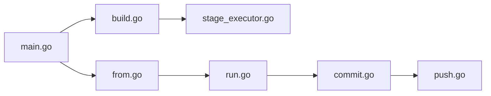

# containers/buildah

> Command-line tool to build OCI images, with or without a Dockerfile, without a daemon.

## The problem
Building an image through the Docker daemon requires root privileges and offers only a rigid script format.

## What it actually does
Creates a working container (`buildah from`), copies files into it or runs commands in it, mounts its filesystem, then commits it as an image (`commit`). Also builds from a Containerfile (`buildah build`). OCI and Docker formats. Fork-exec model, no daemon and no mandatory root, with a reusable Go API (Podman uses it for builds).

## How it is wired


## Trying it
```bash
ctr1=$(buildah from "${1:-fedora}")
buildah config --cmd "/usr/sbin/lighttpd -D -f /etc/lighttpd/lighttpd.conf" "$ctr1"
buildah config --port 80 "$ctr1"
buildah commit "$ctr1" "${2:-$USER/lighttpd}"
```

## Cost and gotchas
Free. Buildah containers are not visible from Podman, and vice versa (separate storage).

## What it is not
Not a long-running execution tool: to manage and run containers, the README points to Podman.

## Alternatives
- Podman: manages, runs and maintains containers; relies on Buildah for builds.

## For you
Adopt for reproducible, daemonless image builds in CI: Apache-2.0, very active.
