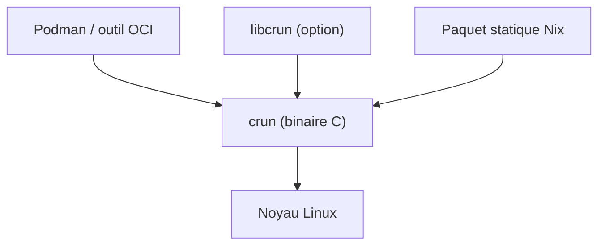

# containers/crun

> OCI container runtime written in C, light on memory, for Linux (Podman, Fedora).

## The problem
Runtimes written in Go, like runc, consume more memory and start more slowly.

## What it actually does
crun complies with the OCI specification and can also serve as a library (libcrun). The README gives a measurement from the author: 100 /bin/true containers in 1.69 s versus 3.34 s for runc. It allows lower memory limits (512k in the example with podman). Releases are signed with a GPG key and a static build via Nix is provided.

## How it is wired
Simplified diagram based on the sheet, no diagram provided.


## Trying it
```bash
./autogen.sh
./configure
make
sudo make install
```

## Cost and gotchas
Free. Build dependencies vary by distribution (libcap, libseccomp, systemd, json-c). For libcrun, add --enable-shared.

## What it is not
It is not a tool you run on its own: an engine (Podman) calls it. The performance figures come from the author's machine. License GPL-2.0.

## Alternatives
runc: more widespread, written in Go, but slower and more resource-hungry according to the README.

## For you
Keep an eye on it: useful only if you administer Linux container hosts; otherwise you use it unseen through Podman.
