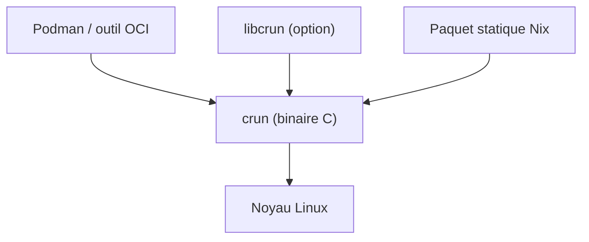

# containers/crun

> Runtime de conteneurs OCI écrit en C, léger en mémoire, pour Linux (Podman, Fedora).

## Le problème
Les runtimes écrits en Go, comme runc, consomment plus de mémoire et démarrent plus lentement.

## Ce que ça fait vraiment
crun respecte la spécification OCI et peut aussi servir de bibliothèque (libcrun). Le README donne une mesure de l'auteur : 100 conteneurs /bin/true en 1,69 s contre 3,34 s pour runc. Il permet des limites mémoire plus basses (512k dans l'exemple avec podman). Les versions sont signées par clé GPG et une construction statique via Nix est fournie.

## Comment c'est branché
Schéma simplifié d'après la fiche, sans diagramme fourni.


## Essayer
```bash
./autogen.sh
./configure
make
sudo make install
```

## Coût et pièges
Gratuit. Dépendances de compilation selon la distribution (libcap, libseccomp, systemd, json-c). Pour libcrun, ajouter --enable-shared.

## Ce que ce n'est pas
Ce n'est pas un outil qu'on lance seul : un moteur (Podman) l'appelle. Les chiffres de performance viennent de la machine de l'auteur. Licence GPL-2.0.

## Alternatives
runc : plus répandu, écrit en Go, mais plus lent et plus gourmand d'après le README.

## Pour toi
Surveiller : utile seulement si tu administres des hôtes de conteneurs Linux, sinon tu l'utilises sans le voir via Podman.

