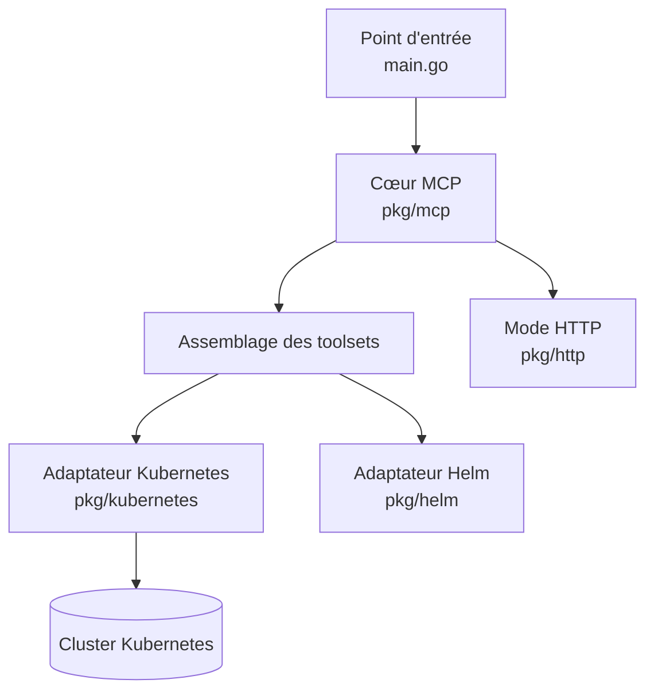

# containers/kubernetes-mcp-server

> Native Go MCP server that gives an AI assistant direct access to the Kubernetes and OpenShift API.

## The problem
Driving a Kubernetes cluster from an AI assistant often requires chaining `kubectl` calls, which are slow and depend on external tools installed on the machine.

## What it actually does
Native Go implementation that talks directly to the Kubernetes API (not a `kubectl`/`helm` wrapper): generic resource management, pods (list/get/delete/logs/exec/top/run), namespaces, events, Helm, and optional toolsets (Tekton, Kiali, KubeVirt). Supports multi-cluster and `read_only`/`denied_resources` safeguards.

## How it is wired


## Trying it
```shell
npx kubernetes-mcp-server@latest --help
```

## Cost and gotchas
Free, single binary with no Node/Python dependency. The `read_only`/`denied_resources` safeguards are best-effort: real access control remains the Kubernetes RBAC of the identity used.

## What it is not
Not a simple `kubectl`/`helm` wrapper: direct implementation of the API. MCP log redactions do not guarantee removal of all sensitive data from tool results.

## Alternatives
No alternative named in the README.

## For you
Adopt to drive Kubernetes clusters from an AI agent in MLOps, with the `read_only`/`denied_resources` safeguards enabled in production.
