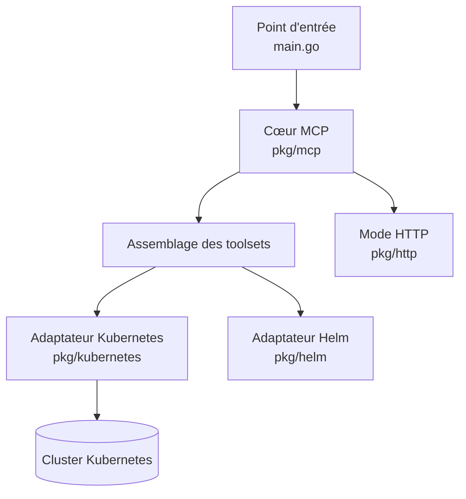

# containers/kubernetes-mcp-server

> Serveur MCP natif en Go qui donne à un assistant IA un accès direct à l'API Kubernetes et OpenShift.

## Le problème
Piloter un cluster Kubernetes depuis un assistant IA nécessite souvent d'enchaîner des appels `kubectl`, lents et dépendants d'outils externes installés sur la machine.

## Ce que ça fait vraiment
Implémentation Go native qui parle directement à l'API Kubernetes (pas un wrapper de `kubectl`/`helm`) : gestion de ressources génériques, pods (list/get/delete/logs/exec/top/run), namespaces, événements, Helm, et toolsets optionnels (Tekton, Kiali, KubeVirt). Supporte le multi-cluster et des garde-fous `read_only`/`denied_resources`.

## Comment c'est branché


## Essayer
```shell
npx kubernetes-mcp-server@latest --help
```

## Coût et pièges
Gratuit, binaire unique sans dépendance Node/Python. Les garde-fous `read_only`/`denied_resources` sont best-effort : le vrai contrôle d'accès reste le RBAC Kubernetes de l'identité utilisée.

## Ce que ce n'est pas
Pas un simple wrapper de `kubectl`/`helm` : implémentation directe de l'API. Les redactions de logs MCP ne garantissent pas la suppression de toute donnée sensible dans les résultats d'outils.

## Alternatives
Aucune alternative nommée dans le README.

## Pour toi
À adopter pour piloter des clusters Kubernetes depuis un agent IA en MLOps, avec les garde-fous `read_only`/`denied_resources` activés en production.

