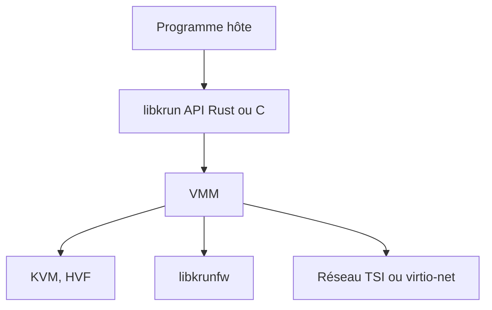

# containers/libkrun

> Dynamic library that runs processes in a lightweight micro-VM (KVM or HVF), in Rust or C.

## The problem
Containers share the host kernel, and a full VM is heavy to embed. There is no simple-to-embed virtualization-based isolation.

## What it actually does
libkrun integrates a virtual machine monitor with the minimum of emulated devices, via KVM on Linux and HVF on macOS ARM64 (Windows announced). The API is in Rust or C. Variants exist for AMD SEV and Intel TDX memory encryption. Networking goes through TSI (transparent socket impersonation) or virtio-net. It is the basis for crun (Podman), krunkit and muvm.

## How it is wired


## Trying it
```bash
make -j11 BLK=1 NET=1 VHOST_USER=1
make -j11 BLK=1 NET=1 VHOST_USER=1 PREFIX="$HOME/.local" install
cd examples
make rootfs
LD_LIBRARY_PATH="$HOME/.local/lib64" ./chroot_vm ./rootfs_fedora /bin/sh
```

## Cost and gotchas
Compilation, libkrunfw installed, and podman for the example rootfs. The `main` branch is libkrun 2.0, incompatible with 1.x: for production, the README asks for a `stable-*` branch.

## What it is not
It is not a ready-to-use container engine. The README warns that the VM boundary does not limit the host resources exposed by devices (see the security model).

## Alternatives
Firecracker and Cloud-Hypervisor, from which libkrun reuses code: more widespread as VMMs, but not libraries to embed.

## For you
Keep an eye on it: useful if you isolate agent runs or untrusted code, but the 2.0 API is still moving.
