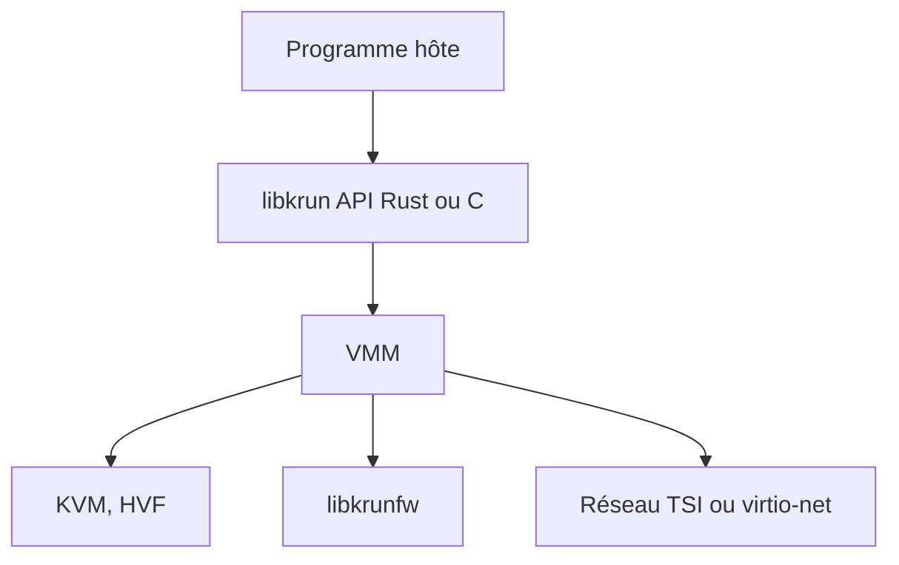

# containers/libkrun

> Bibliothèque dynamique qui lance des processus dans une micro-VM légère (KVM ou HVF), en Rust ou C.

## Le problème
Les conteneurs partagent le noyau de l'hôte, et une VM complète est lourde à intégrer. Il manque une isolation par virtualisation simple à embarquer.

## Ce que ça fait vraiment
libkrun intègre un moniteur de machine virtuelle avec le minimum de périphériques émulés, via KVM sous Linux et HVF sur macOS ARM64 (Windows annoncé). L'API est en Rust ou en C. Variantes pour le chiffrement mémoire AMD SEV et Intel TDX. Le réseau passe par TSI (usurpation transparente de sockets) ou virtio-net. Il sert de base à crun (Podman), krunkit et muvm.

## Comment c'est branché


## Essayer
```bash
make -j11 BLK=1 NET=1 VHOST_USER=1
make -j11 BLK=1 NET=1 VHOST_USER=1 PREFIX="$HOME/.local" install
cd examples
make rootfs
LD_LIBRARY_PATH="$HOME/.local/lib64" ./chroot_vm ./rootfs_fedora /bin/sh
```

## Coût et pièges
Compilation, libkrunfw installé, et podman pour le rootfs d'exemple. La branche `main` est libkrun 2.0, incompatible avec la 1.x : pour la production, le README demande une branche `stable-*`.

## Ce que ce n'est pas
Ce n'est pas un moteur de conteneurs prêt à l'emploi. Le README avertit que la frontière de la VM ne limite pas les ressources de l'hôte exposées par les périphériques (voir le modèle de sécurité).

## Alternatives
Firecracker et Cloud-Hypervisor, dont libkrun reprend du code : plus répandus comme VMM, mais pas des bibliothèques à embarquer.

## Pour toi
À surveiller : utile si tu isoles des exécutions d'agents ou de code non fiable, mais l'API 2.0 bouge encore.

