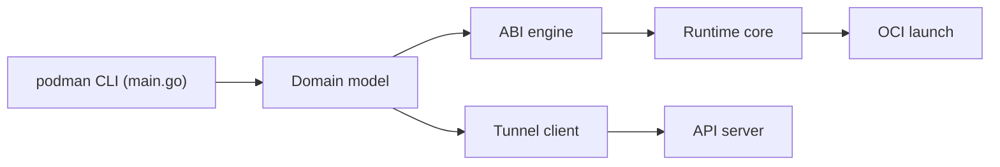

# containers/podman

> Daemonless tool for managing OCI containers, images and pods, including without root privileges.

## The problem
Docker requires a privileged daemon; we want rootless containers that are compatible with existing tools.

## What it actually does
Docker-compatible CLI that manages images (pull, build via Buildah, push), the container lifecycle (checkpoint via CRIU), pods, volumes, networking (Netavark, pasta in rootless mode) and a REST API with two surfaces (Docker-compatible and native). On Mac and Windows, `podman machine` starts a VM. Quadlet generates systemd units. Major releases 4 times a year, only the latest is supported.

## How it is wired


## Trying it
```bash
podman run quay.io/podman/hello
```

## Cost and gotchas
Free. Rootless needs a bit of admin configuration (subuid/subgid). Mac and Windows go through a VM. Does not handle specialized signing/push (Skopeo) nor the Kubernetes CRI (CRI-O). License not filled in in the catalog.

## What it is not
Not an orchestrator: pods are local. Podman and Buildah containers cannot see each other.

## Alternatives
The README names Buildah (image building), Skopeo (signing, push), CRI-O (Kubernetes CRI) and Podman Desktop (interface).

## For you
Adopt: replaces Docker without a daemon for rootless builds and runs in CI or on a workstation, with a compatible API.
