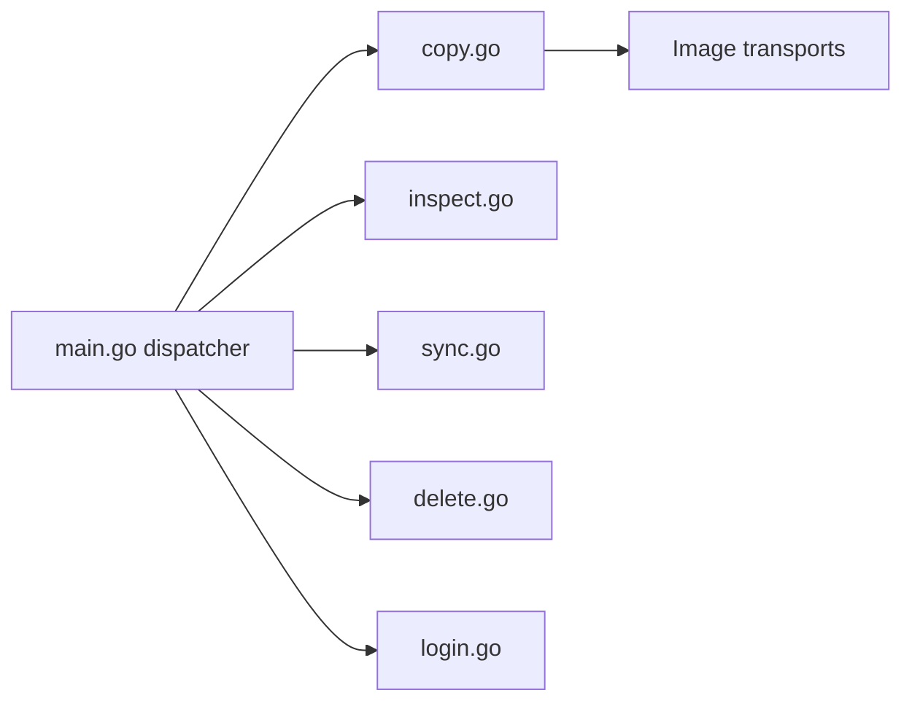

# containers/skopeo

> Command-line tool to inspect, copy and synchronize container images without a daemon.

## The problem
Viewing or moving an image between registries often forces you to download it locally with a daemon and root rights.

## What it actually does
`skopeo inspect` reads the manifest and metadata remotely without pulling the image; `copy` moves between registries, directories, archives or local storage; `sync` replicates to an internal registry or a folder (air-gapped); `delete`, `list-tags`, `login` and sigstore signing. It supports OCI and Docker v2, and requires neither a daemon nor root.

## How it is wired


## Trying it
```bash
skopeo inspect docker://registry.fedoraproject.org/fedora:latest
skopeo copy docker://quay.io/buildah/stable docker://registry.internal.company.com/buildah
skopeo sync --src docker --dest dir registry.example.com/busybox /media/usb
```

## Cost and gotchas
Free. The README states that there is no official website: beware of fake download sites.

## What it is not
It is not a container engine: it neither runs nor builds containers.

## Alternatives
- Buildah: builds images (neighboring repository, same ecosystem).
- Podman: cited as a container management tool.

## For you
Adopt it to mirror or audit images in an MLOps pipeline: lightweight, daemonless, Apache-2.0 and very active.
