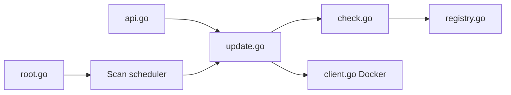

# containrrr/watchtower

> Automatically updates running Docker container images, for homelabs.

## The problem
Keeping your containers' images up to date means pulling and restarting them by hand.

## What it actually does
Watches the selected containers, compares their images with the registry (digest), then stops the container and restarts it with the same options. Scans are scheduled or triggered through an HTTP API, with lifecycle hooks, reports, Prometheus metrics and notifications.

## How it is wired


## Trying it
```bash
docker run --detach \
    --name watchtower \
    --volume /var/run/docker.sock:/var/run/docker.sock \
    containrrr/watchtower
```

## Cost and gotchas
Free, but it mounts the Docker socket. Archived repository: the README declares the project unmaintained.

## What it is not
Not a production tool: the README advises against it and points to Kubernetes, MicroK8s or k3s.

## Alternatives
- Kubernetes, MicroK8s, k3s: recommended by the README for serious environments.

## For you
Skip: archived and unmaintained, it gives access to the Docker socket with no future fixes.
