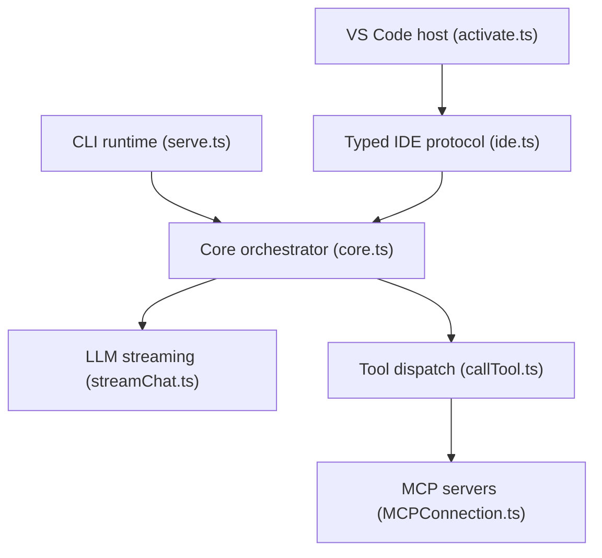

# continuedev/continue

> Coding agent as a CLI, VS Code extension and JetBrains plugin, now frozen as read-only.

## The problem
Plugging a coding assistant into the editor or terminal with the model of your choice.

## What it actually does
The README is very short. From the architecture, a shared TypeScript core handles YAML configuration, the chat stream to providers (OpenAI, Anthropic, Ollama), tools, MCP, code indexing, autocompletion and diff-based edits. A terminal-command safety evaluator exists. The three hosts are the CLI, VS Code and JetBrains.

## How it is wired

## Trying it
No command documented in the README; it points to the online documentation.

## Cost and gotchas
Model providers are on you. The README states that version 2.0.0 is the last one and that anonymous telemetry and authentication were removed.

## What it is not
Not a living project: the README declares the repository unmaintained and read-only, even though the catalogue does not mark it archived. It recommends the CLI over the JetBrains plugin.

## Alternatives
No alternative named in the README.

## For you
A project frozen at its final version: do not build on it, but its core remains readable as an agent-architecture reference; ignore for everyday use.
