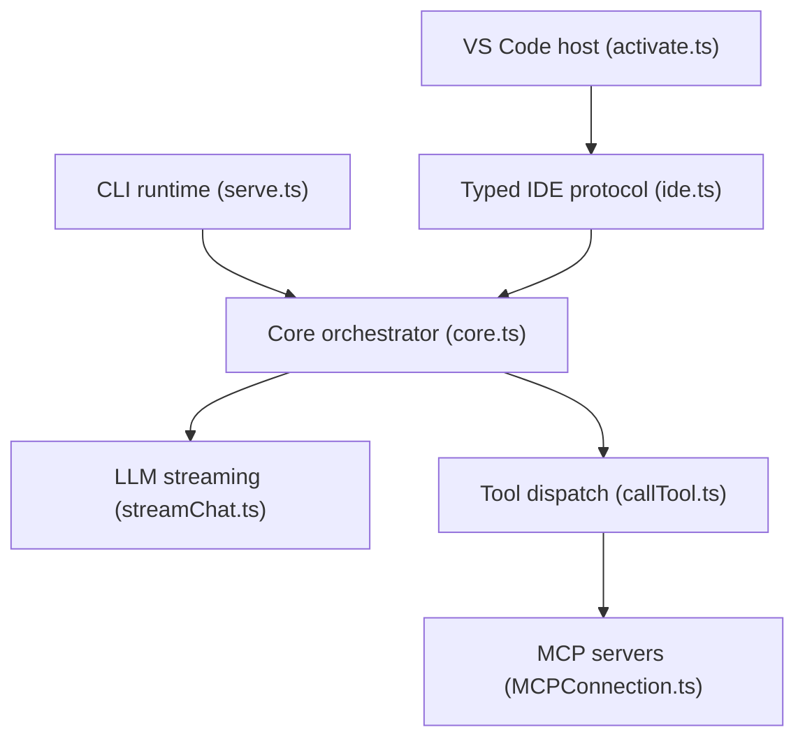

# continuedev/continue

> Agent de code en CLI, extension VS Code et plugin JetBrains, aujourd'hui figé en lecture seule.

## Le problème
Brancher un assistant de code dans l'éditeur ou le terminal avec le modèle de son choix.

## Ce que ça fait vraiment
Le README est très court. D'après l'architecture, un noyau TypeScript commun gère la configuration YAML, le flux de chat vers les fournisseurs (OpenAI, Anthropic, Ollama), les outils, MCP, l'indexation de code, l'autocomplétion et les modifications en diff. Un évaluateur de sécurité des commandes de terminal existe. Les trois hôtes sont la CLI, VS Code et JetBrains.

## Comment c'est branché

## Essayer
Aucune commande documentée dans le README ; il renvoie à la documentation en ligne.

## Coût et pièges
Les fournisseurs de modèles sont à ta charge. Le README indique que la version 2.0.0 est la dernière et que la télémétrie anonyme et l'authentification ont été retirées.

## Ce que ce n'est pas
Pas un projet vivant : le README déclare le dépôt non maintenu et en lecture seule, alors que le catalogue ne le marque pas archivé. Il recommande la CLI plutôt que le plugin JetBrains.

## Alternatives
Aucune alternative nommée dans le README.

## Pour toi
Projet figé en version finale : ne pas bâtir dessus, mais son noyau reste lisible comme référence d'architecture d'agent ; à ignorer en usage courant.

