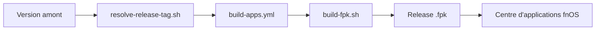

# conversun/fnos-apps

> Dépôt qui reconditionne en paquets .fpk des applications auto-hébergées pour le NAS fnOS, pour les utilisateurs de ce NAS.

## Le problème
Installer sur fnOS des applications de NAS courantes (médias, DNS, monitoring) demande de les empaqueter à la main et de suivre leurs versions.

## Ce que ça fait vraiment
Le dépôt suit les versions amont, construit des fichiers `.fpk` avec un packager commun et les publie en releases GitHub. Environ 150 applications sont listées, dont quelques-unes d'IA (Ollama, Open WebUI, LocalAI, LibreChat, MaxKB). Il ne modifie pas la logique des applications d'origine. Installation manuelle depuis le centre d'applications fnOS.

## Comment c'est branché
Schéma simplifié d'après la fiche, sans diagramme fourni.


## Essayer
```bash
cd apps/plex && ./update_plex.sh
./scripts/new-app.sh jellyfin "Jellyfin" 8097
```

## Coût et pièges
Gratuit, mais il faut posséder un NAS fnOS. Certaines applications annoncent des comptes par défaut (admin/admin) à changer. Les paquets sont des repackages tiers, pas des builds officiels.

## Ce que ce n'est pas
Pas un outil de data ou d'IA : c'est un catalogue de paquets NAS. Pas utilisable hors fnOS. Les applications d'IA listées ne sont que des paquets d'outils existants.

## Alternatives
Aucune alternative nommée dans le README.

## Pour toi
À ignorer sauf si tu as un NAS fnOS : c'est de l'empaquetage d'applications tierces, sans valeur pour un profil data / IA / MLOps.

