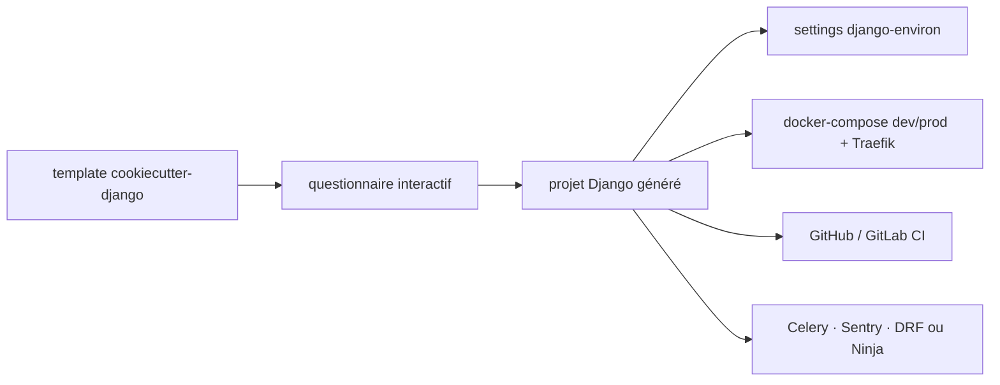

# cookiecutter/cookiecutter-django

> Production-ready Django project generator, configured through an interactive questionnaire.

## The problem
`django-admin startproject` produces a skeleton that you then have to reconfigure by hand:
per-environment settings, authentication, Docker, CI, tests — always the same omissions.

## What it actually does
A Cookiecutter template that asks about twenty questions (name, license, time zone, editor,
PostgreSQL version, cloud provider, mail service, REST API, frontend pipeline, Celery, Sentry,
CI tool…) then generates a Django 6.0 project with 100% test coverage from the start, 12-Factor
settings via `django-environ`, a custom user model, registration via `django-allauth`,
Bootstrap v5, email sending via Anymail, S3/GCS/Azure/nginx media storage, Docker Compose for
development and production (Traefik + Let's Encrypt), a Heroku Procfile and `pre-commit`.

## How it is wired


## Trying it
```bash
uv tool install "cookiecutter>=1.7.0"
uvx cookiecutter https://github.com/cookiecutter/cookiecutter-django
cd reddit/
git init
git add .
git commit -m "first awesome commit"
```

## Cost and gotchas
Free. PostgreSQL everywhere (14 to 18), and configuration goes through environment variables — which
does not work with Apache/mod_wsgi. The cloud options (S3, SES, Mailgun, Sentry, Heroku) involve
third-party accounts and a bill that is on you. After generation you must replace the example
values ('Daniel Greenfeld', 'pydanny'…) with your own.

## What it is not
It is not a framework or a library: it is a generator, run once. The README warns that the project
also serves as a testbed and does not exactly match the book *Two Scoops of Django*. MySQL is not
supported natively.

## Alternatives
- `mabdullahadeel/cookiecutter-django-mysql`: a fork for full MySQL support.
- Fork the repository: the README explicitly encourages maintaining your own variant.

## For you
The right reflex when you need to deliver a Django interface around a model rather than a simple
script — you get Docker, settings and CI in a single command.
