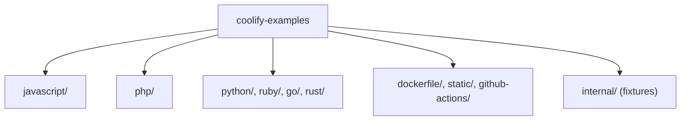

# coollabsio/coolify-examples

> Example applications ready to deploy with Coolify, sorted by language and build method.

## The problem
Knowing how to configure a given framework to deploy it on Coolify takes trial and error.

## What it actually does
The repository contains example projects: JavaScript (Next.js, Nuxt, Astro, NestJS, Vite, Bun…), PHP (Laravel, Symfony), Python (Flask), Ruby (Rails), Elixir, Go, Rust. It also covers single and multi-stage Dockerfiles, static sites and GitHub Actions. An `internal/` folder contains test fixtures, not templates.

## How it is wired
Simplified diagram based on the fiche, no diagram provided.

## Trying it
No command documented.

## Cost and gotchas
Free, but you need a Coolify instance (self-hosted or cloud) to get value from it. A server remains at your expense.

## What it is not
Not Coolify itself. The examples are skeletons, not maintained applications.

## Alternatives
No alternative named in the README.

## For you
Worth watching: useful if you self-host services with Coolify, for example a small Flask API for a model.
