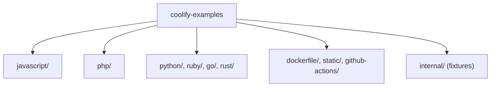

# coollabsio/coolify-examples

> Exemples d'applications prêtes à déployer avec Coolify, classés par langage et par méthode de build.

## Le problème
Savoir comment configurer un framework donné pour le déployer sur Coolify demande des essais.

## Ce que ça fait vraiment
Le dépôt contient des projets d'exemple : JavaScript (Next.js, Nuxt, Astro, NestJS, Vite, Bun…), PHP (Laravel, Symfony), Python (Flask), Ruby (Rails), Elixir, Go, Rust. Il couvre aussi les Dockerfile mono et multi-étapes, le site statique et GitHub Actions. Un dossier `internal/` contient des fixtures de tests, pas des modèles.

## Comment c'est branché
Schéma simplifié d'après la fiche, sans diagramme fourni.

## Essayer
Aucune commande documentée.

## Coût et pièges
Gratuit, mais il faut une instance Coolify (auto-hébergée ou cloud) pour en tirer parti. Un serveur reste à ta charge.

## Ce que ce n'est pas
Ce n'est pas Coolify lui-même. Les exemples sont des squelettes, pas des applications maintenues.

## Alternatives
Aucune alternative nommée dans le README.

## Pour toi
À surveiller : utile si tu auto-héberges des services avec Coolify, par exemple une petite API Flask pour un modèle.

