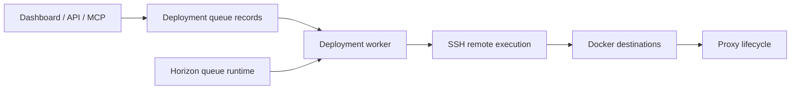

# coollabsio/coolify

> Self-hosted platform for deploying applications, databases, and services on your own servers via SSH.

## The problem
Heroku, Netlify, or Vercel simplify deployment, but they lock users into their cloud environments and billing systems.

## What it actually does
Laravel application with a Livewire dashboard, REST API, and MCP server. It connects to servers via SSH, installs Docker, builds applications (Nixpacks, Railpack, Dockerfile, Compose, pre-built image), and deploys with every Git push. It manages proxies, HTTPS, backups, scheduled tasks, and over 360 services with a single click.

## How it is wired


## Trying it
```bash
curl -fsSL https://cdn.coollabs.io/coolify/install.sh | bash
```

## Cost and gotchas
Free for self-hosting; Coolify Cloud is a paid service. An SSH-accessible server is required. The installation script runs from the network; please review it before proceeding.

## What it is not
Not a Kubernetes orchestrator: it manages Docker or Swarm. The `docs/v5/` directory is a design archive, not the active code.

## Alternatives
Heroku, Netlify, and Vercel, which Coolify replaces as proprietary services.

## For you
Things to watch out for: This is interesting for demonstrating or deploying AI demos or services on your own machines, but it should be tested thoroughly before being adopted as a standard.
