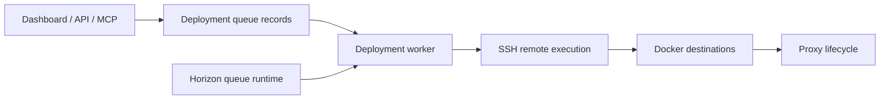

# coollabsio/coolify

> Plateforme auto-hébergée pour déployer applications, bases et services sur ses propres serveurs via SSH.

## Le problème
Heroku, Netlify ou Vercel facilitent le déploiement mais enferment dans leur cloud et leur facturation.

## Ce que ça fait vraiment
Application Laravel avec tableau de bord Livewire, API REST et serveur MCP. Elle se connecte aux serveurs par SSH, y installe Docker, construit les applications (Nixpacks, Railpack, Dockerfile, Compose, image prête) et déploie à chaque push Git. Gère proxy, HTTPS, sauvegardes, tâches planifiées, plus de 360 services en un clic.

## Comment c'est branché


## Essayer
```bash
curl -fsSL https://cdn.coollabs.io/coolify/install.sh | bash
```

## Coût et pièges
Gratuit en auto-hébergement ; Coolify Cloud est payant. Il faut un serveur accessible en SSH. Le script d'installation s'exécute depuis le réseau : le relire avant.

## Ce que ce n'est pas
Pas un orchestrateur Kubernetes : il pilote Docker ou Swarm. Le dossier `docs/v5/` est un archive de conception, pas le code actif.

## Alternatives
Heroku, Netlify, Vercel, cités comme services propriétaires que Coolify remplace.

## Pour toi
À surveiller : intéressant pour déployer des démos ou services d'IA sur ses propres machines, à tester avant d'en faire un standard.

